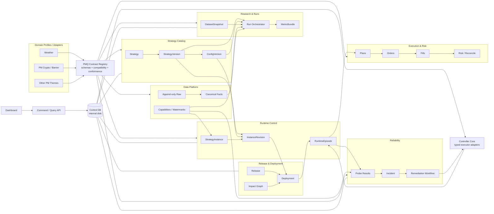
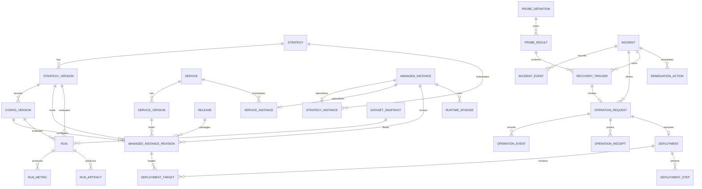
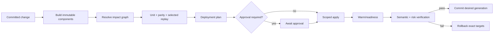

# PM Quant Platform Specification (weather-first)

Status: Reviewed plan; stages A/B implemented and locally tested; production integration not accepted
Updated: 2026-09-06
Spec identity: `pm_quant_platform_spec_v1`
Compatibility path: this filename is retained during migration so existing weather documentation links do not fork into a second platform document
Source of truth: no; current production truth remains `production.yaml` + `weather_production_ctl.py` + manifest/raw/exchange evidence until the migration gates in this document are passed
Supersedes by scope: `WEATHER_STRATEGY_RUNTIME_PLATFORM_DESIGN.md` as the target runtime/control-plane design; it does not supersede current data, analysis, execution, or production contracts

阅读顺序：**§0.2 是本次审阅后的完整执行方案，决定本轮范围、顺序和验收。** §1–17 保留已有设计依据、字段草案和历史证据；未被 §0.2 纳入的扩展项不构成当前开发任务。代码状态与目标设计分开陈述，历史测试通过不等于生产链路已接入或自愈已上线。

## 0. Decision

The project will converge on one database-backed **PM Quant Platform**, with the dashboard as the single human operation entrypoint. Weather is the first and currently dominant domain profile; Polymarket crypto, dispute/rule, sports, politics, and future themes plug into the same platform through typed adapters. Separate domains do not get separate identity, run, metric, runtime, health, deployment, or command protocols.

The key model is not one mutable row containing everything. It is:

```text
Strategy (stable identity)
  -> StrategyVersion (immutable executable decision version)
     -> ConfigVersion (immutable parameter/risk version)
        -> StrategyInstance (stable operational slot)
           -> InstanceRevision (immutable desired binding)
              -> Deployment (change transaction)
                 -> RuntimeEpisode (actual process epoch)

StrategyVersion + ConfigVersion + DatasetSnapshot
  -> Run (backtest / shadow / paper / live evidence)
```

Therefore, the requested “one database record per strategy + version” is adopted as `strategy_version`, while operational state is stored on `strategy_instance` and its desired/observed projections. A version must never be overwritten merely because an instance is paused, restarted, or redeployed.

This is one versioned specification family, not one giant record type or one process that imports every strategy. A small common envelope and shared identities apply at platform integration boundaries; domain payloads and venue adapters stay explicit. Weather is the first workflow integration because it has the strongest production controller and the largest current risk surface. Crypto joins first through read-only descriptors, evidence, runs, metrics, and health adapters; any later command integration requires parity gates and retains its domain executor.

The dashboard never updates process state directly and never executes an arbitrary shell command:

```text
Dashboard -> typed Command API -> durable operation_request
          -> controller claims command -> plan/preflight/apply/verify
          -> observed state + evidence -> dashboard
```

### 0.1 原始设计主轴（执行范围按 §0.2）

- 设计主轴收口为**一个 PM 量化平台、一套版本化协议族、多个领域 adapter**。天气、crypto 和以后其他主题不再各建 strategy/run/health/deployment 协议。
- “一套协议”不是把所有数据硬塞进一张表：公共 envelope、identity、lineage、run、metric、runtime、health、command 只有一个定义；天气城市、CEX funding、Freqtrade trade、Carry financing 等只存在于各自 domain payload/adapter。
- 你的判断成立：`策略 + 不可变版本` 应成为数据库一等对象；但运行状态必须落在独立的 instance/revision/desired/observed 记录，不能把版本行改成“运行中”。
- 看板应成为唯一人工操作入口，但只负责提交 typed command、审批和展示证据；controller 是唯一受限执行器，runner 只做策略决策与业务执行。
- 2026-09-04 事故的设计输入不是“探针把进程杀了”，而是 JRS 权限上下文真实失去读写能力，且不可观测、依赖阻塞和进程失败需要分开。此历史判断不能代替新的现场诊断。
- 自愈必须形成持久化闭环：复用已有内置盘 reliability supervisor，确认根因、合并影响、按依赖顺序验证恢复、保存每一步、超时升级；验收过的安全动作自动做，高风险动作生成可审批的精确恢复单。
- 小模块变更通过 component impact graph 只生成受影响策略的新版本和 instance revision，不再全栈重启；部署的排队、审批、执行、warm-up、验证分别计时，任何阶段都不能无限转圈。
- 回测通过统一 RunSpec + DatasetSnapshot + MetricBundle 收口；看板/API/报告读取同一指标产物，日常分析不再各自翻日志和重算 PnL。
- 实施采用渐进替换：成熟实现原位保留并加 adapter，新协议先做只读投影和语义对照；同一目标始终只有一个执行 owner。旧路径通过 parity gate 后才转为兼容入口。不会重写 Freqtrade/Carry/weather canonical，或为了名字统一而重做成熟模块。

### 0.2 审阅后的完整执行方案 — 2026-09-06

#### A. 结论与本轮边界

采用**模块化单体控制面 + 独立策略进程 + 领域 adapter**。复用现有 controller、reliability supervisor、数据采集、执行对账和看板。共同规范集中在身份、运行记录、指标、健康和操作上；天气与 crypto 的业务计算继续由各自模块负责。

后续实施按本方案验收三条完整链路（本次交付方案，不执行迁移）：

1. `原生历史/回测 artifact → adapter → run/metric 索引 → 只读 API/看板`。
2. `probe → incident → operation/step → 现有 controller → 独立验证/receipt → 自愈或升级处理`，先接一个已登记的 safe shadow 实例。
3. `已提交 release → 精确影响计划 → 单实例部署 → 身份/数据/业务验证 → 完成或有证据的回滚`。

共同数据服务独立运行，下游策略分别消费它们。启动策略 A 只改变 A；依赖失效返回明确原因。依赖的数据源、schema 或输出合同发生变更时，更新生产者并对消费者做兼容验证；只有消费者实际加载代码/config 或输入合同需要变更，才重启对应消费者。数据依赖闭包不等于重启集合。

#### B. 原方案需要修正的地方

| 问题 | 审阅结论与修订 |
|---|---|
| 默认最终由 DB 接管 desired state | 当前保留 committed `production.yaml` 为唯一拓扑来源，DB 保存命令、审计和投影。看板可以提交对应命令，并不要求立刻把配置权威迁进 DB。DB-authoritative 只作为明确业务需求触发的后续选择。 |
| 再建独立 scheduler | 已有 `scripts/ops/production_reliability_supervisor.py` 和内置盘 LaunchAgent。扩展现有 supervisor，按目标切换其修复后端；不并行运行两套自动修复 owner。 |
| 所有写入都加分布式 lease | SQLite 短事务与唯一约束负责一般一致性；单机维护/回填用进程锁。operation 的 lease/epoch 保留用于执行接管，两类锁不混用。 |
| 每次升级都创建 generation、新指针、新库 | prototype 整理可以一次性构建候选库；正常升级使用有版本的事务 migration 和备份。generation 不是日常部署制度，更不是新的长期事实源。 |
| 全平台必须全绿才允许任何动作 | 离线回填和只读查询不依赖每个策略健康。生产切换检查目标及共享故障域；无关异常单列基线，不自动扩大重启范围。主机/DB identity、共享 storage/资金安全异常仍阻断相关操作。 |
| 固定 7 天观察、30 天才清理 | 改为按被修改的行为验收：完整数据/任务周期、故障恢复、重启、回滚与差异报告。周期和样本数随目标写入 rollout 清单，不能用等待天数替代证据。删除保留独立批准边界。 |
| 协议/表/页面一次建齐 | 已有类型和表原位复用；暂不启用全部 catalog 子类型、独立 deployment_step 引擎、七个新页面或多层通用权限体系。部署用同一 operation/workflow step，并增加有类型的部署 payload。 |
| 持久化工作流等于安全自愈 | DB 只能记录进度，无法与 tmux/launchd 的副作用组成一个事务。需要执行前检查、结果不确定时的 reconcile、执行端互斥和接管验证，才能上线。 |
| “统一指标”意味着统一金融计算 | materializer 只验证并存储 claim；fee/PnL 仍由现有领域权威计算。看板读同一 profile/bundle，不把 Freqtrade 仿真、PM shadow funnel 与实际 fill 混为同一绩效。 |

#### C. 职责与唯一 owner

| 模块 | 负责的事实/行为 | 本轮实现位置与复用点 |
|---|---|---|
| 身份与合同 | strategy/version/config、实例与 revision、schema/profile 与兼容规则 | `src/platform/contracts`、现有 adapters；registry 跟随代码发布，不单独做 registry 服务 |
| 共享数据层 | source/raw、标准数据产品、PIT、watermark 和数据质量 | 现有 weather/crypto producer；同一产品一个 owner，按城市/品种/源声明订阅 |
| 策略 runtime | 消费输入、决策、输出既有 lineage | 独立策略进程；controller 不 import 策略执行主循环 |
| 执行与核算 | risk、订单、fill、fee、结算、资金与对账 | 复用已验证的领域实现；platform 保留引用和摘要 |
| Run 与指标 | 原生结果接入、身份绑定、可复现等级、指标索引 | `src/platform/adapters/backtests.py` 与 `platform_*_materializer.py` |
| 控制与可靠性 | 操作计划、授权、执行互斥、incident、retry、验证 | 现有 supervisor + workflow store + weather/crypto controller adapters |
| 展示 | 查询目录/运行/指标、显示异常与操作进度、提交 typed command | 复用当前看板，先补运行结果、实例状态、操作时间线三个视图 |

DB 不进入逐 tick 决策热路径。control API/DB 不可用时，既有 runtime 依照其已加载的风险和数据合同运行；新管理操作暂停接收。控制查询必须能在 JRS 不可用时工作：先拆除 control 路由对 canonical DB 的启动硬依赖；若当前 analytical API 的进程上下文使它做不到，再单独部署一个轻量 control API，共用代码和认证。

#### D. 最小数据与扩展合同

1. **策略/版本/实例分开**：稳定 strategy ID；不可变 code/decision version；每个 strategy version 对应自己的 config version；稳定 instance + immutable revision；process episode 记录实际加载版本。沿用 `managed_instance.instance_kind` 区分服务/策略，不为当前不需要的每个 subtype 新建表。研究状态、desired、observed 和审批状态分开。
2. **两张依赖关系**：`uses_component` 描述加载的代码/config，决定测试和替换范围；`requires_data_product` 描述共享输入，决定 readiness/降级范围。先维护显式依赖和已有 release 映射，不开发自动 Python import 全图或独立图数据库。映射不完整的共享变更必须列出未知消费者，不能声称影响面精确。
3. **Run identity**：平台 ID 带 source namespace，保留 native run ID；同一 RunSpec 可以多次运行，每次有不同 run ID。Freqtrade batch 下每个策略绑定独立 `(strategy_version_id, config_version_id)`。RunSpec 冻结 engine/version、参数、数据语义、环境 lock/ref、seed（适用时）和指标 profile；显式填入版本 ID 不等于证明历史 artifact 就由该版本生成，绑定证据需可查询。
4. **Dataset identity**：内容身份由冻结的数据清单、schema、PIT 截止和相关版本决定；清单文件的路径、生成时间和包装格式属于 provenance。相同数据的不同包装允许引用同一 dataset；同一 ID 内容发生变化必须拒绝。复用源项目 snapshot ID 并记录源 namespace 与完整内容 digest，不另外强制搬运一份全量数据。
5. **Artifact 接入和运行引擎分阶段**：现有 PM Barrier adapter 接的是 zero-notional forward-shadow，标为 `run_kind=shadow`；Freqtrade 接原生 backtest 报告。第一步完成已有结果查询。统一发起运行只包一层已登记的原生入口、状态与产物，不重做原生 engine；同一策略的回测/实盘逻辑复用在域内实现，不强迫所有域共用一个 engine。
6. **Metric**：`value/unit/status/as_of/grain/formula/denominator/source_refs/profile/dimensions` 必须明确。可用值为有限 Decimal string；没有可计算值时为 null 并附缺口原因，不能填 0。`partial/stale` 是否允许带数值由 profile 定义。实际改变 v1 值域时提供显式 reader compatibility/version migration，不静默改变旧 hash。仅有历史 summary 的记录可展示为证据不足，不进入可复现或 live promotion 分母。
7. **指标版本**：历史 claim 不覆盖。补 settlement/fee/修复结果时创建新的 evaluation/bundle revision，关联原 run 和修复证据；同一冻结 bundle 的语义槽只有一份 claim。先用现有 record envelope/run relation 表表达，实际查询需求出现后才加专用表。
8. **新模块最小接入包**：descriptor、声明的输入输出 schema/profile、source/version identity、实际适用的 adapter，以及正常/缺数据/重复输入/未知版本 fixture。仅需要生命周期管理的模块再实现 health/recovery；仅有副作用的模块再实现 plan/execute/verify/reconcile。不要求普通研究脚本完成部署、资金授权和所有金融指标。

现有实现继续作为基础，但不能把 current-code hash 当历史 source-code attestation，也不能把 profile 名称相同当作每一项必需指标已经齐全。

#### E. 存储、并发与新库问题

长期保留一个内置盘 platform control DB，服务 weather、PM crypto、Freqtrade 等目录/操作/结果索引。领域事实留在原有库。control DB 的增长限于摘要、事件与 artifact 指针；高频探针保留状态变化和故障证据，完整高频样本按运行预算放 artifact，避免把原始 tick 或所有逐笔回测行塞进控制库。

当前 prototype 候选路径可以使用 `runtime/platform/generations/<migration_id>/platform_control.db`；所有入口最终通过一个受管路径配置解析活动库，只有一个活动 generation。只读审计副本不接收操作。**此次建议新建候选库是为了验证可重建的 prototype，不是因为 append-only 原则禁止一切 schema migration。** 上次审计的 252 条 `final` 状态是兼容缺口：保留旧值/旧 envelope 的来源证据，按已登记 adapter 映射或重算派生摘要，不能直接 UPDATE 旧 immutable claim。该数字是 2026-09-05 快照，执行前重查。

连接与维护保持简单：

- 所有写入口共用 `open_control_db`：受管根路径、真实路径/device/inode、DB identity/schema version 检查；拒绝 canonical/其他已知业务库、其 symlink/hardlink 别名及非受管已存在数据库。先验证再初始化；防误路径不仅靠文件名。
- schema migration 只由独立维护命令执行；平时 store/materializer 只检查 schema，不在每次业务调用里跑 DDL 或提交调用者事务。
- 单机 WAL、外键、有限 busy timeout、短事务；操作审计连接采用满足掉电持久性要求的 synchronous 设置。较慢的解析、数据 hash 与回测在写事务外运行，批量回填可暂停，不饿死 operation 更新。
- 维护锁使用宿主机文件锁覆盖连接排空、schema 变更和切换全过程；正常写入由 SQLite 串行化事务，无需为每个 materializer 造一套持久 lease。执行操作的 epoch/fencing 是另一项保证，保留。
- 使用 SQLite 一致性 backup 并验证恢复，不能直接复制运行中的 `.db` 而遗漏 WAL。WAL 的同机/单写者及备份行为以 [SQLite WAL](https://www.sqlite.org/wal.html)、[Backup API](https://www.sqlite.org/backup.html) 为依据。

prototype 切换前重新检查是否已有不可重建的 operation、approval、receipt。若存在，就必须完整迁移账本并对账，不能只从 artifact 回填。切换时暂停控制写入、排空任务、固定截止点、处理增量、关闭旧连接、更新活动路径、重开连接并验证 DB identity；原子替换符号链接本身不会让已打开的 SQLite 连接切库。

正式库接收新命令后，回滚代码应继续使用兼容的新账本；有新状态时不得简单把活动指针退回旧快照。需要前滚修复或维护窗口内受控迁移。普通新增列/index 等兼容升级优先采用备份 + 事务 migration；不要求反复重建 generation。

#### F. 自愈的最小完整闭环

复用现有内置盘 supervisor 作为调度 owner，host service manager 负责拉起它。DB 持久化 incident/operation；controller 执行已登记动作。observe、plan、apply 是显式运行模式。逐目标切换修复后端，新 ledger 接管某目标时，旧 `apply_one_safe_repair` 对同目标必须停用。

```text
probe（包含 observer/context 和证据时间）
  → 分类目标状态与观测状态 → incident episode + impacts
  → 有版本的 recovery policy → operation + workflow_step
  → controller 检查目标身份/依赖/权限 → action → verify
  → succeeded / bounded retry / needs_attention / escalated
```

- **incident 分组**：active dedupe key 是故障域 + 根能力 + 归一化指纹；incident ID 还包含 episode identity。同一活动故障更新 impacts；解决后复发产生新 episode 并关联前例。多个独立根故障不能被“第一个不健康 upstream”吞掉；原因不明保存 unknown 和候选证据，不虚构根因。
- **观测独立性**：独立确认指不同有效观测路径/故障域及正向证据，不是换一个 executor 字符串或重复读同一个失败文件。缺观测可修复探针自身并升级处理；不能由此推出业务进程死亡。probe freshness 与业务是否处于应产出时间窗分别判断。
- **安全类别按影响面确定**：shared collector 即使没有下单权限，也可能影响 live consumer；自动动作先核对其完整影响集合和既有恢复合同。最初只启用独立 safe shadow 的精确恢复，shared/JRS/live 逐项验收后启用。
- **执行幂等**：先写 attempt intent，再调用动作，再写 receipt。若动作已发生但 receipt 未落库，接管后先 inspect/reconcile：目标已达标则补验证；未知结果进入待处理；只有证明尚未执行才重做。以 runtime episode、loaded SHA、注册 session identity 和动作 token 判断，不只看 PID 存在。
- **执行端隔离**：DB fencing 只能拒绝陈旧写入，不能停止一个已经离开 DB 的旧进程继续执行 shell。现有 controller 增加按目标/共享资源的执行互斥，并在副作用前重新校验 epoch、批准范围/有效期、manifest revision、pause owner 和风险。旧 executor 未停止且无法隔离时，不启动第二个 executor。
- **预算与收敛**：deadline、attempt、cooldown 从持久记录恢复；控制器重启不能刷新预算。动作失败、验证失败和结果未知区分处理；通知是持久状态的消费者，发消息失败不能回滚真实动作或重复执行。
- **审批适配当前团队**：先用已认证操作者 + 精确计划确认 + 可审计期限，复用现有身份和 live 确认合同。多用户职责分离、OIDC、多人审批在部署环境需要时增加；不能为了满足架空角色流而让单人平台不可操作。默认不启用自动 live/JRS 接管。

健康验收同时看 process、readiness、最新完成的业务工作、输入 freshness、下游消费情况。叶策略启动不碰其他链路；共享源恢复后先验证源输出，健康的消费者自行继续，不一律重启。权限宿主或储存迁移是维护事务，不因一次普通 strategy restart 触发。

#### G. 部署与看板收口

部署沿用 full SHA/immutable checkout + 注册脚本。部署是 operation 的一种 profile，复用 step/receipt，不再新增另一套相似的重试状态机。先记录排队、preflight、checkout/环境、stop/start、warm-up、verify 的耗时，按实际最慢阶段优化。简单 wrapper 只有在能消除已证明的重复逻辑时合并。

看板先显示三类信息：策略实例的 desired/observed/loaded version；run 的指标/缺口/输入版本；operation/incident 的时间线及下一步。先接只读接口，使用分页轮询和 cursor；现有 event/outbox 留作后续 SSE/通知输入。API 复用认证，并对 mutation 做服务端权限、scope、CSRF/Origin（cookie 场景）和 idempotency 校验，后端解析目标和注册入口，不能接受任意 shell/path。

部署计划含精确目标、old/new revision、预期停机、资金/依赖影响、deadline、验证与回滚条件。生产运行过程中已产生订单/fill 时，回滚 release 也不能回退订单或去重状态；必须在保留执行事实的基础上按域内合同恢复。最后用原实例集合、loaded SHA、input/output watermark、raw/订单/fill 与 API 一起验收。

#### H. 实施顺序与验收门

| 阶段 | 实际交付 | 验收与回退 |
|---|---|---|
| A：修可上线缺口 | 共用 DB opener、维护锁/显式 migration；修 incident episode；补执行接管合同；修 metric 空值、Freqtrade per-strategy config 和 dataset identity | 内存/临时文件故障测试；旧入口仍可用，生产不需要因此重启。每个修复附失败样例和影响对象。 |
| B：结果链路可用 | 一个 import/validate 入口支持 weather history、PM Barrier shadow、Freqtrade backtest；候选 DB + manifest + parity report；API/看板只读 | 同一冻结来源对齐 identity/数值/分母/单位和条数；缺版本/源漂移单列；原生报告与新 reader 双读，重跑无重复，源文件未改。回退读配置即可。 |
| C：接入既有可靠性闭环 | 以 §17.4 的原生 supervisor 为当前唯一执行 owner；事故/修复日志增量投影到既有 ledger/RecordEnvelope。原 ledger 驱动 safe apply 方案暂不启用，不建立第二套调度 | 原生恢复验收沿用事故 runbook 的证据；本接入另验游标原子性、重复/迟到事件、控制库不可用不阻断恢复、原生预算与授权不变。生产接入仍需独立切换验证。 |
| D：精确部署与操作入口 | 看板/CLI 共享 typed operation，单实例 release transaction、回滚和阶段耗时 | 真实 safe shadow 部署/重启/回滚各完成一次；共享数据 consumer parity；无额外进程 epoch 变化；重试不重复副作用。 |
| E：按需求扩展 | 第二个 domain 的 safe runtime 接同一接口；再逐项接 guarded live/shared recovery | 各自 controller/credential scope 保持边界，通过实际执行及对账合同；DB desired-authority 迁移不作为本阶段前置条件。 |

A/B 的离线工作可与既有生产异常诊断并行。2026-09-05 的 Tokyo `degraded_missing_active_source` 是历史基线，不能沿用为 9 月 6 日的当前状态；执行生产操作前重新核对目标。无关 shadow 异常不阻断 B；若目标依赖该数据源，或故障证明共享 identity/权限有问题，则阻断 C/D 对应动作。

migration manifest 只包含可验收内容：代码/schema/adapter 版本、源 artifact hash/冻结水位、旧库备份身份、目标库 identity、对象计数、转换/拒绝/缺口清单、parity 规则与结果、切换/回滚入口。`总输入 = 成功 + 去重 + 拒绝/隔离 + 无法映射` 必须对齐；转换过字段不要求整个 envelope hash 与旧格式相等，要求语义保持和转换血缘可追踪。历史数据不完整时不能伪称全量可复现。

观察时间由实际节奏确定：周期任务覆盖一次完整输入→输出→展示周期，再覆盖重复执行；常驻进程覆盖已登记刷新/业务窗口和必要的故障演练；重启/login/JRS/TCC 等维护行为只有在声称支持时做相应真实验收。低流量阶段不能以“没报错”当作有足够验证样本。

#### I. 旧链路如何退出与未来如何扩展

切换单位是具体 producer/consumer/repair target，而不是整个“旧平台”。旧读端退出需要 query parity；旧 writer/repair 退出需要唯一 owner 和真实接管证据。建立一张映射表：旧入口、新入口、当前消费者、切换证据、回退入口、状态。旧入口不再调度/新增依赖后标 `superseded-for-now` 或 `read-only compatibility`，保留原始证据和回滚包。域内成熟 runner、canonical facts、原始 artifacts 并不因外层 adapter 上线而废弃。

以后扩展只在需求出现时实施：

| 触发条件 | 扩展 |
|---|---|
| 实测短事务优化/分批后仍有持续写争用，或需要多主机管理写入 | control store 迁 PostgreSQL，保留合同；不使用共享网络 SQLite |
| 任务数量/依赖已超出单机 bounded worker 的运维能力 | 独立队列或 workflow engine；接口沿用 operation/run，不改每个策略 |
| 完整 repo checkout/环境准备仍是主要部署耗时 | 引入可验证的 module build artifact；继续保持 loaded code identity |
| 高频消息 fan-out 和延迟无法由现有数据产品满足 | 增加消息总线/数据传输 adapter；不让策略各建同一份采集链 |
| 多人协作、远程访问或审计合规明确要求 | 更细的角色、OIDC、多审批人、签名审计；不是当前单机必建基础设施 |
| Git-first 配置发布无法满足已量化的操作需求 | 单独设计 DB desired-authority 切换；明确唯一 owner、bootstrap 和账本回滚语义 |

#### J. 本次审阅证据与待修清单

以下为原始代码审阅记录。当时仅修订方案；随后用户授权的 A/B 实施、修复与验收见 §17.2，生产自愈仍未启用。

| 优先级/阻断范围 | 证据 | 待修动作 |
|---|---|---|
| P0，任何控制库写入口 | `analyze_weather_strategy_daily_coverage.py` 直接 `sqlite3.connect(args.platform_control_db)`；catalog CLI 的路径保护未统一到库层 | 共用受管 DB opener，验证错误路径/别名不会创建表或更改 schema |
| P1，incident 上线 | `PlatformWorkflowStore.persist_plan` 只按 root/fingerprint 构造 incident ID；隔离内存库注入 resolved 投影后复发，实际报 `UNIQUE constraint failed: incident.incident_id` | 区分 active dedupe key 与 episode ID，覆盖正常 resolve→recur 全流程 |
| P1，自动执行上线 | `claim_next_step` 接管后把未完成步骤重新 claimed；DB 无法证明外部副作用是否完成；审批检查目前主要发生在 claim | 加 executor inspect/reconcile、资源互斥、第一副作用及后续高风险步骤的授权/epoch/版本复核 |
| P1，指标完整展示 | `MetricEnvelope.__post_init__` 强制数值字符串；隔离调用 `status=missing_evidence,value=None` 实际被拒绝 | 定义 nullable 值域/缺失状态和兼容迁移；不以虚构零值过校验 |
| P1，Freqtrade 多策略入库 | `load_freqtrade_backtest` 只有单个 `config_version_id` 参数；`_catalog_binding` 要求它归属每个不同 strategy version | 按策略传完整 version/config 绑定并校验历史证据；补真实多策略 persistence 测试 |
| P1，相同数据复用 | `_insert_dataset_snapshot` 将 input manifest 的文件 hash 作为 dataset_hash 一部分，manifest 生成时间/路径变化可能使相同 source snapshot 冲突 | 分离内容身份与 artifact 包装 provenance；补同数据不同包装、同 ID 内容冲突测试 |
| P1，常态写入/迁移 | `initialize_platform_control_schema` 含 DDL、commit/executescript；backtest/history/catalog 路径仍会调用初始化 | 明确 schema 维护边界，普通 store 只检查，验证迁移失败/掉电/重复调用和锁竞争 |

审阅范围：本 spec，以及直接相关 controller/supervisor、adapter、store/materializer 和测试路径；不是全仓代码审计。两项失败复现在独立内存 DB/纯 DTO 上执行；未读取当天订单或把历史 health/test 数字当当前生产证明。Nautilus 的 [live reconciliation](https://nautilustrader.io/docs/latest/concepts/live/) 支持“启动/恢复先核对外部事实”的设计参考；这里仍使用现有领域 controller，未引入其 engine。

## 1. Why the current system is not stable enough

### 1.1 2026-09-04 probe incident as a design input

The production reliability history shows three distinct conditions that the current state model partially conflated:

1. Around 09:19 Beijing time, a LaunchAgent last-exit probe marked the manifest critical and then resolved.
2. Around 10:09, `weather_market_books` reported an unaccepted health status, propagated critical state to a live execution-control dependency, and a safe restart took about 102 seconds before recovery.
3. From 10:37:47, runtime health files became `unreadable:PermissionError` across multiple services. The incident opened at 10:38:58. From 10:48:25, the canonical JRS write probe also failed. The reliability state continued accumulating hundreds of critical cycles; many downstream restart attempts were blocked by unhealthy dependencies, while the root probe/context condition had no automatic remediation action.

The probe did not itself stop the processes. It exposed that the permission-bearing JRS context could no longer read/write the target paths. The platform then amplified that shared failure into many projected runtime failures and had no durable workflow that could recover the root context. Some records also contained `tmux_session_missing`, but this evidence set does not independently prove that every affected process exited; health-observation failure, confirmed capability failure, observed session absence, and derived dependency impact must remain separate facts.

Evidence seal for this design input:

```text
timezone                     stored UTC; Beijing time = UTC+08:00
source artifact              ~/Library/Application Support/pm_agents/
                             production_reliability/events.jsonl
root/aggregate event key     weather.manifest.degraded
first affected evidence      2026-09-04T02:37:47.852579Z
aggregate incident opened    2026-09-04T02:38:58.402077Z
JRS capability event key     weather.jrs_context.unhealthy
first JRS impact             2026-09-04T02:48:25.243824Z
first JRS incident opened    2026-09-04T02:49:35.839643Z
confirmed capability fact    socket weather-data-feed-jrs could not write
                             /Volumes/jrs/weather_data_feed_service_runtime
health-only evidence         health_path_unreadable:PermissionError
derived evidence             dependency_unhealthy:<upstream>
later event-stream behavior  JRS context resolved/reopened in multiple episodes;
                             bulk dependent resolutions recorded at 11:11:01Z
```

Supporting controller state is in `production_reliability/state.json`, `latest.json`, `repair_actions.jsonl`, and `jrs_context_failure_state.json` beside that event stream. These are mutable operational artifacts; the timestamps and event keys above are the stable audit coordinates for this design, not a claim about current status after 11:11:01Z.

This exposes five architectural defects:

- Probe execution failure and target failure share the same severity path.
- `unreadable` is treated too much like positive evidence that the runtime is failed.
- Dependency failures are expanded into many child incidents rather than collapsed into one root-cause incident plus an impact set.
- Repair selection is per finding, not a persisted dependency-aware recovery plan.
- A one-shot repair attempt cannot resume a multi-step recovery transaction after a controller, tmux, network, or permission-context failure.

Safety-oriented fail-closed behavior remains correct for new risk. Killing or repeatedly restarting healthy work because a probe cannot observe it is not correct.

### 1.2 Current control fragmentation

Current strategy/runtime meaning is spread across:

- git source and package manifests;
- `instances.yaml` historical/catalog records;
- `production.yaml` releases, desired processes, dependencies, and recovery policy;
- `strategy_def`, `strategy_config`, `strategy_instance`, runtime and control-log tables;
- raw JSON/JSONL health artifacts scanned into read models;
- strategy registry and family living documents.

These sources are useful, but they do not share one typed identity and state model. The platform cannot reliably answer, with one query:

- What is this strategy?
- Which immutable decision version and config is this instance running?
- Which release and dependency versions are loaded?
- Which backtests validate that exact assembly?
- What is desired, what is observed, and what is merely unobservable?
- Which command changed it, who approved it, and how was it verified?

## 2. Architecture principles

1. **One identity, several explicit lifecycles.** Research maturity, desired runtime state, observed process health, data capability health, deployment progress, and incident status never share one `status` field.
2. **Immutable versions, mutable bindings.** Code, config, dataset, metric contract, risk policy, release, and instance revision are immutable. Only desired/observed projections and workflow current state are mutable, with append-only events for every transition.
3. **Git authors; the control DB records operations.** Code and reviewable manifests originate in committed git. The database owns command/approval/audit history and observed projections; desired topology remains a projection of committed `production.yaml`. Moving desired authority is optional future work, not a prerequisite for dashboard operations.
4. **The controller is the only runtime executor.** The dashboard and API submit domain commands. They do not start tmux, call start scripts, alter files, or write process rows as if execution succeeded.
5. **Control plane survives data-plane failure.** Control metadata and command/incident state live on the Mac internal disk, not only inside the JRS canonical analytical DB. A JRS outage must remain observable and operable from the control plane.
6. **Probe health is separate from workload health.** An unauthorized, timed-out, or malformed probe produces `UNOBSERVABLE`, not `FAILED`, unless there is independent positive failure evidence.
7. **Risk fails closed; process recovery stays evidence-based.** Unknown required market/data state blocks new order creation, but it does not by itself authorize killing a process, rebuilding a permission host, cancelling orders, or modifying positions.
8. **One decision core across modes.** Backtest, shadow, paper, and live use the same strategy decision package; clocks, data adapters, and execution adapters vary.
9. **Logs are drill-down evidence.** Standard questions are answered from typed runs, metrics, commands, deployments, incidents, and lineage—not by searching free-form logs.
10. **No second parallel platform.** New tables and APIs first project existing truth, then take ownership behind explicit parity gates. Legacy paths become read-only only after the new path proves equivalence.

### 2.1 External design anchors

This design borrows proven mechanisms, not the infrastructure size or product surface of another platform:

- [QuantConnect LEAN](https://www.quantconnect.com/docs/v2/writing-algorithms/key-concepts/algorithm-engine) streams historical data through the algorithm in fast-forward mode so the same algorithm can run in backtest and live, while its [live reconciliation contract](https://www.quantconnect.com/docs/v2/writing-algorithms/live-trading/reconciliation) explicitly measures mode differences. This supports one decision core plus explicit clock/data/execution adapters and a parity report—not pretending simulation and live fills are identical.
- [NautilusTrader](https://nautilustrader.io/docs/latest/concepts/live/) runs the same actors, strategies, and execution algorithms in backtest and live, and restores/reconciles venue state before strategy startup. This supports keeping strategy logic out of the process supervisor and making reconciliation a startup gate.
- [MLflow Model Registry](https://mlflow.org/docs/latest/ml/model-registry) separates stable registered identity, immutable versions, run lineage, and mutable deployment aliases. This supports `Strategy -> StrategyVersion -> Run`; this platform goes further by requiring an instance revision and deployment receipt before a live binding changes.
- [Kubernetes controllers](https://kubernetes.io/docs/concepts/architecture/controller/) separate desired state from current state and continuously reconcile them. This supports the controller pattern, but not Kubernetes adoption: our controller may execute only registered financial-risk-aware contracts.
- [Temporal durable execution](https://docs.temporal.io/) persists workflow progress so work can continue after process or infrastructure failure. This supports append-only operation/deployment steps, leases, retries, and compensation; it does not require introducing Temporal at current single-host scale.

### 2.2 Current implementation audit and reuse decisions

The repository already contains most of the mechanisms needed by the target platform, but they are split across generations and domains. The 2026-09-04 inventory found **43** weather managed runtimes, **32** independently pinned releases, and **42** distinct start scripts. The start scripts contain 2,462 lines in total; 27 are at most 50 lines and are mostly declarative launch wrappers, while 15 contain enough custom behavior to require an adapter before replacement. The same scan found 132 schema-version constants across 89 Python files. Those numbers do not mean 132 protocols are wrong; they show that there is no single registry telling producers and readers which contracts are canonical, compatible, domain-only, or historical.

| Existing implementation | Decision | Reason and target role |
|---|---|---|
| `src/strategies/runtime/production.yaml`, `production.py`, production release tooling and controller | **Keep, then extract common types** | Full-SHA identity, immutable checkout, registered launch contract, dependency order, dry-run and guarded live confirmation are mature safety mechanisms. The weather-specific parser/controller becomes the first adapter to shared `RuntimeServiceSpec`, `ReleaseAttestation`, `HealthReport`, and `OperationReceipt`; it is not rewritten first. |
| Weather canonical `signals/plans/orders/fills`, adjustment/evidence tables and account reconciliation | **Keep as weather/PM fact profile** | Append-only facts, correction lineage and exchange reconciliation are stronger than a generic replacement. The platform indexes them through common lineage references; it does not flatten city/settlement fields into the universal schema. |
| `weather_edge_v1` execution journal | **Keep business reducer; share storage primitive** | Claim, orphan reclaim, attempt-before-side-effect and outcome semantics are live safety boundaries. Only locking, framing, hash/envelope and corruption handling should move to a common `JournalSink`. |
| `src/platform/execution_runtime.TradeIntent` plus `PaperPlan/PaperOrder/PaperFill` | **Canonical for new non-live PM work** | It already has deterministic identity and cannot grant live authority; `rule_lawyer` already consumes it. Weather's older `weather_city_trade_intent_v1` receives an adapter and stops gaining new fields. |
| Weather live `ExecutionIntent` / child-order runtime | **Keep as authorized execution profile** | It owns live risk checks, claim/reconcile and side effects. It shares lineage and vocabulary with `TradeIntent` but must not be replaced by a research DTO that can accidentally acquire live authority. |
| `src/platform/quote_runtime` and `src/strategies/pmm` execution/risk classes | **Consolidate at the existing seam** | Most PMM files are already thin re-exports of `platform/quote_runtime`. Freeze wrappers as compatibility imports; all new implementation goes into the platform core. PMM backtest/config/strategy variants remain domain modules. |
| `src/platform/engine` and `src/platform/execution/executor.py` | **Dormant architecture frame** | The event DTOs have no durable identity/schema/lineage, and the executor explicitly mocks network success. No production or new strategy may depend on it as an execution authority. Preserve until its remaining PMM users migrate; do not invest in turning the mock into the live gateway. |
| `src/platform/strategy_runtime/store.py` and `runtime/strategy_runtime.db` | **Stop expansion; compatibility adapter only** | It combines catalog, mutable process state, telemetry, orders and fills in another database. It overlaps both canonical trade facts and newer strategy tables, and is still used by the dormant PMM engine/legacy dashboard. New weather/crypto work must not write to it. |
| `weather_strategy_runtime_registry`, `strategy_def/strategy_instance/strategy_instance_runtime`, and `weather_data_monitor_instance` | **Consolidate through projection** | These are three overlapping management models in the canonical DB. Import all into the target catalog/managed-instance read model, publish conflicts, then turn legacy registries read-only after parity. No table is deleted in this project phase. |
| Multiple JSONL append helpers | **Refactor by durability class** | A locked append helper, unlocked weather appenders, read-all-before-append dedupe, async best-effort PMM logging and live execution journaling have different semantics. Provide `append_durable`, `append_best_effort` and `replace_derived_view`; never hide record loss or weaken the execution reducer. |
| Polymarket Alpha `CommonEnvelope`, canonical hash and compatibility checks | **Promote primitives, not the whole Alpha model** | Strict immutable envelope, provenance, canonical JSON and unknown-major rejection are good platform foundations. Alpha-specific record types and its blanket no-float rule remain a profile rather than a dependency of every high-frequency in-memory tick. |
| Crypto `manifest-envelope-v1`, Freqtrade run/data manifests | **Adopt as the starting artifact/run envelope** | They already record Git context, input/output hashes, dataset snapshot and limitations. Extend rather than create a weather-only artifact manifest. |
| Crypto forward-validation evidence | **Promote PIT/revision semantics** | `observed/available/decision/input_max` clocks, immutable terminal evidence, denominator identity and revisions are common research requirements. Weather's clock contracts map into the same profile. |
| Crypto Carry dashboard metric envelope | **Promote metric provenance** | `value/unit/status/as_of/source_refs/formula_id/denominator_ref/quality_flags` solves the current log and denominator inconsistency. Carry balance-sheet and financing objects themselves remain domain-specific. |
| Crypto PM5M shell/launchd runtime and health scripts | **Highest-priority runtime adapter debt** | A large action dispatcher, launchd labels, direct `pgrep`, notification and cross-repository credential reads mix ownership. First emit shared runtime/health contracts; then replace hard-coded dispatch behind a controller adapter while launchd remains the process carrier. |
| Freqtrade, CEX/OKX/Hyperliquid, Carry financing and options engines | **Leave as domain adapters** | Their market, margin, funding, asset-lot, liability, collateral and multi-leg semantics are real differences, not protocol duplication. They must emit platform identities/evidence/metrics without being rewritten into weather abstractions. |

This yields a deliberate rule: **reuse behavior where semantics are already strong; unify interchange contracts and control ownership; adapt genuine domain differences; retire only proven duplicate write paths.** File moves, broad renames, storage migration and framework replacement are not architectural progress by themselves.

### 2.3 The one protocol family

“One protocol” means one namespace, registry, compatibility policy and set of mandatory cross-cutting contracts. It does not mean one table, one Python base class, one database, or one controller process.

New platform integration boundaries use the registered contract family. Native raw records and domain protocols remain valid behind adapters; this does not require rewriting every existing durable record. Domain schemas may be profiles beneath `pmq.*`, for example `pmq.decision_candidate.weather.v1`; they reuse common identity meanings.

#### `RecordEnvelopeV1`

The minimum persisted/interchange envelope is:

```text
schema_id + schema_version
record_id + record_type
producer_id + producer_version
created_at_utc + occurred_at_utc nullable
strategy_id + strategy_version_id nullable
config_version_id + instance_id + run_id nullable
correlation_id + causation_id nullable
provenance_refs[]
payload_profile + payload_sha256
payload
```

The envelope is required for records accepted into the platform contract boundary. Native JSONL, engine artifacts and hot market-data transport retain their established formats; the platform adapter produces the envelope and references the source without rewriting it. This is not an envelope-per-tick requirement.

Canonical hashing and ID construction come from one implementation. Money, quantity, fee and executable price fields use exact decimal or minor-unit encodings at durable execution/accounting boundaries. Model arrays and hot in-memory calculations may use floating point when their profile declares tolerance and canonical serialization. This preserves Alpha's exactness where it matters without imposing an expensive blanket rewrite.

#### Core contract catalog

| Canonical contract | Common meaning | Domain-owned payload |
|---|---|---|
| `StrategyDescriptorV1` | stable identity, family/domain, lifecycle, owner, required capabilities | thesis, universe and research metadata |
| `ModuleDescriptorV1` | immutable module/version, code and package digest, entrypoint, inputs/outputs, config schema, capabilities | adapter-specific launch/config details |
| `ArtifactManifestV1` | artifact identity, Git/build context, inputs/outputs, hashes, limitations and retention | dataset/file layout |
| `EvidenceTimeV1` | observed, first-seen, available, decision, input-max, effective and label clocks | source clock derivation |
| `LineageRefsV1` | correlation/causation and references across the canonical decision/execution chain | stage-specific facts |
| `DecisionCandidateV1` | candidate grain, strategy/policy identity, target/instrument mapping, decision time, evidence status and selection state | city/bracket, barrier, rule, sport, symbol or other feature facts |
| `EconomicIntentV1` | authority-free intent identity, action kind, one or more instrument legs, constraints, dedupe and exposure scope | Polymarket token, CEX position target, quote set, carry/hedge legs |
| `RunSpecV1` | strategy/config/code/dataset/execution/environment identity and run lifecycle | runner arguments and domain universe |
| `MetricEnvelopeV1` | value, unit, grain, denominator, formula, status, as-of, CI and evidence refs | domain metric dimensions |
| `RuntimeServiceSpecV1` | desired state, release, launch adapter, dependencies, capabilities, health and recovery policy | tmux/launchd/Freqtrade/container details |
| `ReleaseAttestationV1` | full source SHA, package/config/contract hashes and loaded-runtime evidence | repository/build mechanism |
| `HealthReportV1` | probe execution, target observation, capability state, freshness and evidence | source-specific diagnostics |
| `OperationV1` | typed command, approval, lease, steps, receipts, rollback and audit | domain command payload |

The canonical stage vocabulary remains:

```text
EventEnvelope -> DecisionContext -> ModelOutput -> DecisionCandidate
              -> EconomicIntent(profile) -> plan(profile)
              -> order fact -> fill fact -> settlement/close fact
```

`EconomicIntentV1` is a small venue-neutral envelope and is never sufficient proof of live authority. Its legs reference registered instruments rather than assuming a Polymarket `condition_id/token_id`. The existing `src/platform/execution_runtime.TradeIntent` becomes the **Polymarket single-leg, non-live profile** (`PolymarketTradeIntentV1`); it remains canonical for weather, rule-lawyer and PM crypto research, but it is not imposed on Freqtrade, CEX, Carry or multi-leg strategies.

Live execution requires an independently validated `ExecutionAuthorization` scoped to venue/account/credentials and produces the existing stronger domain `ExecutionIntent`/child-order contract. Polymarket non-live execution produces `PaperPlan/PaperOrder/PaperFill`; a Freqtrade adapter may produce a position/order profile, and Carry may produce a multi-leg financing profile. Profiles share `RecordEnvelope`, `LineageRefs`, dedupe, exposure and evidence semantics; they do not share a class whose fields or authority are false for the domain. This security and semantic boundary is intentional and must not be “simplified” away.

#### Compatibility and evolution rules

1. Each schema has one registry entry: owner, current version, readers, writers, compatibility range, canonical implementation, fixtures, migration adapter and retirement state.
2. A minor version may add optional fields with stable defaults and may not change identity, units, grain, authority or state semantics. Any such change is a new major version.
3. Writers emit only the current approved version. Readers declare accepted versions; unknown major versions fail closed. Temporary dual-read/projection comparison windows have an owner and removal gate. Shadow copies are not independent command authorities or permission to execute an action twice.
4. Identity fields and canonical serialization are immutable inside a major version. An adapter may translate an old record but may not silently reinterpret it in place.
5. `extensions` are namespaced and registered. Unstructured JSON is not allowed to become a second hidden protocol used by downstream business logic.
6. Persisted enums include an explicit unknown/unsupported handling policy. A consumer must not treat an unknown state as healthy, filled, settled or authorized.
7. Every adapter publishes loss accounting: accepted, rejected, quarantined, deduplicated and unrepresentable records. Parity is measured, not asserted.
8. Conformance is profile-based. A module must pass the common envelope/identity/evidence rules plus every profile it declares; it is neither required nor allowed to fabricate fields from an unrelated venue/profile.

### 2.4 Module conformance specification

Every registered platform module supplies a descriptor for the profiles it actually implements. The following is the full field catalog, not a requirement that every research script supply runtime, account or recovery fields:

```text
module_id + module_kind + domain
module_version + full_code_sha + package_digest
entrypoint + execution_environment
input_contracts[] + output_contracts[]
config_schema_id + config_hash
intent_profiles[] + metric_profiles[]
required_capabilities[] + provided_capabilities[]
health_contract_id + recovery_policy_id
data_roots[] + venue_scopes[] + account_scopes[]
credential_scope_refs[] + executor_fencing_domain
owner + lifecycle_state + compatibility_range
```

A module is compatible when its declared profiles pass the applicable gates below; non-applicable gates are explicitly omitted, not satisfied with invented values:

1. schema validation and canonical round-trip;
2. golden fixtures for every declared input/output major version;
3. idempotency and duplicate-delivery tests for durable consumers;
4. PIT/clock validation for decision-producing modules;
5. append-only or correction-lineage validation for facts;
6. no-live-authority test for research/shadow modules;
7. health failure-mode tests distinguishing `FAILED`, `DEGRADED`, `BLOCKED` and `UNOBSERVABLE`;
8. adapter loss/parity report against the legacy implementation;
9. RunSpec/MetricBundle reproducibility for strategy modules;
10. release attestation and rollback receipt for production modules.

Reuse the actual implementation layout; add subpackages only when they contain independently useful behavior:

```text
src/platform/contracts/       canonical envelope, identities and schemas
src/platform/control_plane/   registry, impact and recovery planning
src/platform/adapters/        domain and native artifact adapters
weather_dashboard/db/platform_*  existing persistence/materializers
tests/platform/               adapter/contract fixtures (DB tests remain in tests/weather_dashboard/)
```

Existing weather and crypto modules remain where they are. They conform through imports or adapters; wholesale directory moves are not a gate.

## 3. Domain map and ownership



| Domain | Owns | Does not own |
|---|---|---|
| Strategy Catalog | stable strategy identity, immutable versions, parameter schema, required capabilities, owners and research maturity | process PIDs, live orders, data freshness |
| Research & Runs | RunSpec, dataset seal, backtest/shadow evidence, metric contract, comparison and promotion evidence | production process mutation |
| Data Platform | source adapters, raw capture, PIT availability, watermarks, canonical facts and dataset snapshots | strategy selection, capital allocation, deployment |
| Release & Deployment | immutable release, impact plan, rollout phases, verification and rollback | strategy decisions and exchange reconciliation |
| Runtime Control | desired vs observed state, process episodes, dependency ordering and controller receipts | editing strategy code/config |
| Execution & Risk | plan/order/fill lifecycle, idempotency, caps, pause-new-risk, exchange state and account reconciliation | process supervision and research promotion |
| Reliability | probe identity, SLOs, incidents, root-cause grouping and bounded remediation | inventing business state from missing evidence |
| Accounting | cash, reserved notional, positions, fees, settlement and realized/MTM PnL | health inference or deployment |
| Dashboard/API | authenticated commands, approvals, read models and evidence display | direct DB patches, arbitrary shell/tmux and hidden fallback calculations |

## 4. Control-plane storage boundary

### 4.1 Physical placement

Use a small control database on the Mac internal disk. SQLite WAL is sufficient for the current single-host control plane; retain an abstraction that permits Postgres if multi-host active writers are introduced later.

The JRS canonical `weather.db` remains the weather analytical/fact database. Crypto JSONL/SQLite/Freqtrade and future domain stores also remain in place initially. None of them is allowed to become the only home of cross-domain commands, approvals, incidents, desired state, strategy identity, run identity, or contract registration. The platform must diagnose and recover a domain data-store outage while that store is unavailable.

Recommended split:

```text
Internal-disk control DB
  strategy/version/config registry
  instances and desired state
  commands/approvals/deployments
  runtime current state/events
  probes/incidents/remediation
  run metadata and artifact pointers

Domain analytical DBs + raw stores
  weather canonical DB and raw evidence
  crypto/Freqtrade/CEX source stores
  source events and snapshots
  signal/plan/order/fill/settlement facts by profile
  dataset materializations
  large run artifacts and metric detail
```

The control DB stores hashes, identities, summaries, and pointers—not duplicated trade truth or large artifacts.

### 4.2 Authority during and after migration

| Phase | Desired runtime authority | Control DB role | `production.yaml` role |
|---|---|---|---|
| Current / Phase 0-1 | `production.yaml` only | read-only desired projection; versions/incidents/evidence may be registered | sole desired topology |
| Phase 2 | `production.yaml` only | command/audit authority; executable commands may not change desired topology | sole desired topology |
| Phase 3-4 | committed, controller-activated `production.yaml` revision | workflow/deployment authority; desired rows remain a read-only projection | sole runtime desired topology and rollback target |
| Optional future authority cutover | acknowledged control-DB desired generation | sole operational intent + event audit | recovery snapshot only; signing depends on the security profile |

There must never be a phase where operators can independently edit both sources and expect reconciliation to guess which wins.

Concretely:

- In Phases 0-2, `instance_desired_state.authority_mode=projection`; the dashboard cannot mutate it. Restart/reconcile may execute against the exact YAML generation, while pause/resume and deployment remain plan-only because they would change desired topology.
- In Phases 3-4, every desired-state/deployment command references an already committed and validated manifest revision. The controller performs the registered git-first activation transaction, then writes the receipt and refreshes the DB projection. A DB row cannot override YAML.
- Only a separately approved future authority-cutover transaction may change `authority_mode` to `authoritative`. It is not required by §0.2 stages A–E. Such a change must define one acknowledged generation and a verified bootstrap snapshot; operators must not independently edit both sources.

## 5. Core relational model

This is a logical field/relationship catalog, not a mandate to create every table. §0.2 specifies the current minimum. Reuse existing generic managed-instance and workflow tables; subtype/deployment views may be projections until a concrete query or integrity requirement justifies another table.



The ER diagram focuses on strategy lineage. The runtime control plane also manages non-strategy workloads. `StrategyInstance` is one subtype of a generic managed workload, alongside collector, API, execution-control, monitor, and infrastructure services.

### 5.1 Immutable catalog/version tables

#### `strategy`

Stable business identity; one row per strategy concept/family member.

```text
strategy_id UUID PK
strategy_key UNIQUE
display_name
family
domain
owner
portfolio_state         research | dormant | retired
created_at_utc
retired_at_utc nullable
```

`portfolio_state` is research/governance status. It says nothing about whether any process is running.

#### `strategy_version`

One immutable row per executable decision version.

```text
strategy_version_id UUID PK
strategy_id FK
version_label
full_code_sha
package_digest
entrypoint
decision_contract_hash
parameter_schema_hash
model_artifact_digest nullable
manifest_json
created_by
created_at_utc
UNIQUE(strategy_id, full_code_sha, package_digest, decision_contract_hash)
```

A shared module change creates a new executable closure/package digest for every affected strategy version. It does not mutate historical versions.

Validation/approval/revocation state is a projection of separate evidence/events referencing this version, not a mutable field inside its immutable identity.

#### `component_version` and `strategy_version_component`

These tables build the impact graph needed for scoped deployment.

```text
component_version(component_version_id, component_key, code_sha, digest, api_contract_hash)
strategy_version_component(strategy_version_id, component_version_id, dependency_kind)
```

Examples of components: decision core, weather feature adapter, market-book client, execution gateway, risk engine, canonical reader, common runtime harness.

#### `config_version`

```text
config_version_id UUID PK
strategy_version_id FK
params_canonical_json
params_hash
schema_hash
risk_policy_version_id FK
execution_policy_version_id FK
source_policy_version_id FK
created_by
created_at_utc
UNIQUE(strategy_version_id, params_hash, schema_hash)
UNIQUE(strategy_version_id, config_version_id)
```

Parameters are validated against the version's parameter schema. Editing creates a new row.

#### `policy_version`

Risk, execution, and source behavior are independently versioned instead of being mutable JSON embedded in an instance.

```text
policy_version_id UUID PK
policy_kind            risk | execution | source
schema_version
canonical_json
policy_digest
validation_state       registered | validated | approved | revoked
created_by
created_at_utc
UNIQUE(policy_kind, policy_digest)
```

The three foreign keys on `config_version` must point to matching `policy_kind` values; schema constraints/triggers enforce this rather than API convention.

#### `release`

An immutable, deployable assembly—not a branch name or a mutable checkout.

```text
release_id UUID PK
release_key
full_source_sha
build_manifest_hash
dependency_lock_hash
artifact_digest
schema_compatibility_hash
built_by
built_at_utc
signature nullable (security-profile dependent)
UNIQUE(release_key, full_source_sha)
```

#### `service`, `service_version`, and `service_instance`

Collectors, APIs, monitors, execution-control processes, and infrastructure are versioned without pretending they are strategies.

```text
service(service_id PK, service_key UNIQUE, service_kind, owner, lifecycle_state)

service_version(
  service_version_id PK, service_id FK, version_label, full_code_sha,
  package_digest, entrypoint, runtime_contract_hash,
  provided_capabilities_hash, required_capabilities_hash,
  validation_state, created_by, created_at_utc
)

service_instance(
  managed_instance_id PK/FK, service_id FK, purpose,
  created_at_utc, retired_at_utc nullable
)
```

### 5.2 Operational topology tables

#### `managed_instance`

All controller-managed processes share one operational identity and state model. This prevents collectors and APIs from being mislabeled as strategies merely to reuse runtime control.

```text
managed_instance_id UUID PK
instance_key UNIQUE
instance_kind         strategy | collector | data_service | execution_service |
                      api | monitor | infrastructure
domain_profile
environment           research | shadow | paper | live | shared_production
host_selector
executor_adapter_id
executor_fencing_domain
venue_scope nullable
account_scope nullable
created_at_utc
retired_at_utc nullable
```

`executor_fencing_domain` is the smallest mutation-ownership boundary, normally host + venue + account scope. Two workers cannot hold a valid lease for the same fencing domain. A weather worker cannot claim an OKX/account operation, and a crypto worker cannot claim the weather CLOB account merely because both can see the same control DB.

`service`, `service_version`, and `service_instance` provide immutable versioning for non-strategy components. A `strategy_instance` and a `service_instance` each map one-to-one to `managed_instance`; desired/observed state, operation, deployment, incident, and runtime episode tables target `managed_instance_id`.

Deferred integrity constraints enforce exactly one subtype: `instance_kind=strategy` requires one `strategy_instance`; every other kind requires one `service_instance`.

#### `strategy_instance`

A stable operational slot, such as one named tiny-live or shadow instance.

```text
managed_instance_id PK/FK
strategy_id FK
purpose
created_at_utc
retired_at_utc nullable
```

#### `managed_instance_revision`

Immutable complete desired binding.

```text
managed_instance_revision_id UUID PK
managed_instance_id FK
strategy_version_id FK nullable
config_version_id FK nullable
service_version_id FK nullable
release_id FK
dependency_set_hash
runtime_contract_hash
declared_spec_hash
authority_scope_hash
credential_scope_ref nullable
created_by
created_at_utc
CHECK(exactly one version family is bound for the managed_instance kind)
FOREIGN KEY(strategy_version_id, config_version_id)
  REFERENCES config_version(strategy_version_id, config_version_id)
```

For a strategy instance, `strategy_version_id` and `config_version_id` are required and `service_version_id` is null. For a service instance, the reverse applies. A deferred integrity trigger also enforces that the bound `strategy_version.strategy_id` matches `strategy_instance.strategy_id`. `credential_scope_ref` is an opaque secret-manager/keychain reference identity—never secret material—and must belong to the instance's fencing domain. This preserves one operational workflow without using an unenforced polymorphic owner reference.

#### `instance_desired_state`

```text
managed_instance_id PK/FK
desired_state          running | paused | disabled
desired_revision_id FK -> managed_instance_revision
generation INTEGER
authority_mode         projection | authoritative
source_generation
source_hash
pause_owner            operator | system_dependency | system_risk nullable
blocked_capability_id nullable
auto_resume_policy_id nullable
requested_by
requested_at_utc
reason
approval_ref nullable
controller_ack_generation nullable
updated_at_utc
```

Updates use optimistic concurrency on `generation`. Before Phase 5 this table is a controller-written projection of `production.yaml`, not an independently editable desired-state source. `pause_owner` prevents recovery from resuming an operator-owned pause; a system-owned pause may resume only under its recorded policy and capability condition.

#### `instance_observed_state`

Current projection only; every change also emits an append-only event.

```text
managed_instance_id PK/FK
observed_revision_id FK -> managed_instance_revision nullable
process_state          unknown | starting | running | stopping | stopped | crashed
service_state          unknown | ready | degraded | blocked | failed
probe_state            fresh | stale | unobservable
pid_or_session
host_id
controller_epoch
latest_probe_result_id FK nullable
last_heartbeat_at_utc
last_data_at_utc
last_decision_at_utc
last_order_at_utc
observed_at_utc
evidence_ref
```

#### `runtime_episode` and `instance_state_event`

`runtime_episode` identifies each actual managed-process epoch and loaded release/config. `instance_state_event` is append-only and records desired/observed transitions, actor, command correlation ID, evidence, and controller receipt.

### 5.3 Commands, approvals, and deployments

#### `operation_request`

```text
operation_id UUID PK
idempotency_key UNIQUE
operation_type         plan | deploy | pause | resume | restart | reconcile | rollback | recover
target_type
target_id
incident_id FK nullable
expected_generation
executor_fencing_domain
authority_scope_hash
risk_class             read_only | safe_non_live | live_guarded | break_glass
requested_payload_json
payload_schema_version
payload_hash
reason
requested_by
state                   draft | validating | awaiting_approval | queued |
                        claimed | executing | verifying | succeeded |
                        blocked | needs_attention | escalated | expired |
                        failed | rolled_back | cancelled
lease_owner nullable
lease_until_utc nullable
attempt_count
created_at_utc
started_at_utc nullable
finished_at_utc nullable
error_code nullable
```

Every transition writes `operation_event`; execution outputs a typed `operation_receipt` with before/after evidence. The request/event transaction also appends a `control_outbox` row, so API/SSE delivery cannot race the durable state transition. Claiming requires an exact executor capability and fencing-domain match; approval is bound to `authority_scope_hash`, so changing venue/account/credential scope invalidates it. A controller crash releases the lease and another controller epoch in the same fencing domain can resume from the last committed workflow step. `blocked` names a known dependency/precondition; `needs_attention` asks for a bounded human decision; `escalated` records an expired retry/approval SLO and never means “keep retrying forever.”

#### `approval`

```text
approval_id
operation_id FK
policy_key
actor_id
actor_role
decision
confirmation_digest
decided_at_utc
valid_until_utc
revoked_at_utc nullable
revocation_reason nullable
```

Live rollout/restart, higher caps, JRS context recovery, storage migration, order cancellation, and liquidation have separate policies. “Stop process” never implies “cancel order” or “liquidate position.”

#### `deployment` and `deployment_target`

One deployment is an auditable transaction over exactly the impacted instances.

```text
deployment
  deployment_id
  operation_id
  plan_hash
  impact_graph_hash
  from_manifest_hash
  to_manifest_hash
  state + current_phase
  controller_epoch
  desired_generation_before nullable
  desired_generation_commit nullable
  failure_code nullable
  rollback_deployment_id
  timestamps

deployment_target
  deployment_id + managed_instance_id PK
  previous_revision_id
  desired_revision_id
  phase
  state
  preflight_ref
  verify_ref
  rollback_ref

deployment_step
  deployment_step_id
  deployment_id + managed_instance_id nullable
  ordinal + step_kind
  state + attempt_number
  lease_owner + lease_until_utc
  deadline_at_utc
  controller_epoch
  idempotency_key
  input_hash
  operation_receipt_id nullable
  failure_code nullable
  started_at_utc + finished_at_utc nullable
```

The `deployment_step` shape above is implemented through the existing operation/workflow step and receipt models, not a second executor or retry engine. Attempts retain immutable evidence; current state is a projection. An explicit commit point helps recovery, but external effects still require inspect/reconcile before retry or rollback (§0.2 F/G).

### 5.4 Research/run tables

#### `dataset_snapshot`

```text
dataset_snapshot_id
domain_profile
dataset_manifest_hash
source_store_identities
canonical_projection_identity nullable
catalog_build_id
source_snapshot_hashes
PIT_cutoff_utc
label_cutoff_utc
fee_model_version
execution_model_version
created_at_utc
```

#### `run`

```text
run_id
run_kind               backtest | replay | shadow | paper | live
domain_profile
strategy_version_id
config_version_id
dataset_snapshot_id nullable only for open live runs
universe_version_id
runtime_engine_adapter
runtime_engine_version
environment_lock_hash
metric_contract_version
seed
repro_hash
status                 queued | preparing | running | evaluating |
                       succeeded | failed | blocked | cancelled
parent_run_id nullable
timestamps
```

`repro_hash` covers the complete immutable execution closure, not just config/code/date.

`run_metric` stores a `MetricEnvelopeV1`: metric name/version, value/unit, grain, denominator identity, status, source/formula references, quality flags, confidence interval and calculation time. `run_artifact` stores `ArtifactManifestV1` pointers. Logs remain an artifact type, not the result schema.

## 6. State machines

### 6.1 Strategy and instance states

```text
Strategy portfolio:  research <-> dormant -> retired

Version promotion:   registered -> validated -> approved -> revoked/retired

Desired runtime:    disabled <-> paused <-> running

Observed process:   unknown -> starting -> running -> stopping -> stopped
                                      \-> crashed

Service health:     unknown -> ready <-> degraded -> blocked
                                      \-> failed

Probe health:       fresh <-> stale <-> unobservable
```

Rules:

- Research portfolio state and version promotion state are independent. A `validated` version may belong to a strategy currently marked `dormant`, and it may have no running instance.
- A `running` desired instance may be `blocked` because a required capability is unavailable.
- `probe_state=unobservable` cannot directly set `process_state=crashed`.
- `service_state=blocked` may automatically pause new risk while leaving the process alive for state/reconciliation.
- Auto-resume is allowed only when the same required capabilities become fresh and the pause was system-owned, not operator-owned.

### 6.2 Deployment state

```text
draft -> planned -> validating -> awaiting_approval -> queued
      -> applying -> warming -> verifying -> succeeded
                                  |             |
                                  v             v
                               failed -> rolling_back -> rolled_back
```

Every phase has a deadline, retry policy, idempotency key, evidence contract, and rollback boundary. Phase timing is visible in the dashboard, so a deployment cannot merely appear to “hang.”

### 6.3 Incident and remediation state

```text
detected -> confirming -> diagnosed -> remediation_planned
         -> executing -> verifying -> resolved
                         |              |
                         v              v
                      retry_wait     reopened
                         |
                         v
                      escalated
```

Incident identity is based on root cause and failure domain, not one row per downstream symptom. Child impacts are edges on the incident.

## 7. Probe, health, and self-healing design

### 7.1 Three separate facts

`probe_definition` versions the observation contract: target capability/instance, target reference, executor-class requirement, cadence, timeout, evidence-age rule, and interpretation policy. Every immutable `probe_result` stores:

```text
probe_result_id
probe_definition_id + definition_version
executor_id + executor_version + executor_epoch
context_id             caller/TCC/tmux socket/session identity where applicable
target_ref             capability, instance, path/URL and expected device identity
attempt_number
started_at_utc + completed_at_utc
probe_execution_state  succeeded | timeout | unauthorized | malformed | runner_failed
observation            positive_healthy | positive_failed | no_observation
target_evidence_time   timestamp of the workload evidence being evaluated
last_positive_at_utc
independent_probe_result_id nullable
error_code + error_class + error_message_digest nullable
observed_state_event_id nullable
evidence_ref
```

Sensitive values are redacted before persistence, but executor/context identity is not omitted. This is what distinguishes “the process failed” from “this specific permission-bearing observer cannot see it.” `instance_observed_state.latest_probe_result_id` links the current projection back to the exact evidence.

Examples:

| Probe result | Workload interpretation | Allowed automatic action |
|---|---|---|
| Probe unauthorized, recent heartbeat/output exists | observability degraded | repair/restart probe path only |
| Health file malformed, process and newer output exist | probe contract failure | quarantine bad observation; do not restart process |
| Process exit observed, session absent, safe non-live policy | crashed | dependency-aware restart |
| Required market data stale | service blocked | pause new order creation; keep process/reconcile alive |
| Exchange unavailable | execution degraded/blocked | block sends, continue state reconciliation and retry budget |
| Canonical JRS write probe failed | storage capability unavailable | stop new writes/risk; start guarded recovery workflow; no child restart storm |

### 7.2 Evidence fusion

Do not use blind majority voting. Compute service health from named evidence with explicit semantics:

- process/session identity;
- runtime heartbeat;
- successful work/output timestamp;
- dependency capability freshness;
- semantic progress;
- exchange acknowledgement where applicable;
- probe executor health.

The system must retain the last-known-good observation and its age. Missing current evidence moves through `fresh -> stale -> unobservable`; it does not manufacture a failure fact.

### 7.3 Capability graph

Dependencies are capabilities rather than only process names:

```text
market_books.rest.current
polymarket.rules.current
polymarket.clob.books.current
polymarket.clob.account.<account_scope>.reconcile
weather.observation.tokyo.current
weather.forecast.hourly.current
jrs.runtime.read
jrs.runtime.write
clob.orders.submit
clob.orders.reconcile
canonical.fact_trades.read
crypto.candles.<venue>.<symbol>.<timeframe>.current
crypto.account.<venue>.<account_scope>.reconcile
crypto.funding.<venue>.current
```

Every capability is namespaced by domain/venue and, for mutation or private state, by account scope. `strategy_version_requirement` declares required/optional capability, maximum age, and blocked behavior. A source problem then affects only dependent instances and run types; capability matching cannot widen an executor's fencing domain.

Non-strategy services declare the same contract through `service_version_requirement`, so the controller can build one capability DAG without pretending that a collector or dashboard API is a strategy.

### 7.4 Recovery policies

| Tier | Examples | Automation |
|---|---|---|
| 0 — observe | re-probe, use an independent probe executor, refresh read model | automatic |
| 1 — safe | restart probe worker, safe non-live collector, expired shadow process | automatic with bounded retries |
| 2 — guarded | restart live runtime with registered pause/restart contract, recover market route | pre-approved policy or dashboard approval |
| 3 — break glass | recreate JRS permission host, storage migration, cancel/liquidate | explicit high-risk approval and preserved pre-state |

Recovery is topological:

```text
root capability -> producer -> canonical adapter -> strategy runtime -> execution
```

The planner first repairs the root. It verifies recovery before releasing dependent steps. It never spends all retry attempts restarting children while the root dependency is known unavailable.

### 7.5 Recovery trigger and independent owner

A durable recovery workflow needs an owner outside the failure domain being observed. Extend the existing internal-disk `production_reliability_supervisor.py`, supervised independently of JRS, to evaluate versioned policies and advance the ledger. Do not add another scheduler. The following describes the logical trigger shape:

```text
recovery_trigger_id
recovery_policy_version_id
root_capability_id
dedupe_key
first_failure_at_utc
failure_streak + failure_duration_sec
confirming_probe_result_ids
independent_executor_id
affected_instance_set_hash
allowed_auto_actions
approval_policy_id nullable
escalation_deadline_utc
incident_id
workflow_operation_id
state                   observing | confirmed | planned | awaiting_approval |
                        executing | verifying | resolved | needs_attention |
                        escalated | expired
```

Trigger semantics:

1. A single ambiguous probe result starts `observing`; it cannot restart the target.
2. Policy-specific streak/duration plus an independent observation confirms a root capability incident. Exactly one scheduler owner holds the incident/workflow lease for the dedupe key.
3. The scheduler automatically groups affected instances, blocks only the declared unsafe writes/new-risk capabilities, produces a topological plan, runs Tier 0/1 steps, and records deadlines/receipts.
4. If the next action is guarded or break-glass, it automatically creates a ready-to-review operation with pre-state and exact impact; it does not merely continue emitting `critical` cycles.
5. Timeout, exhausted retry budget or failed independent confirmation leads to `needs_attention/escalated`. Scheduler loss is observed externally and the host service manager handles process restart; a dead scheduler cannot record its own escalation. On return it reconciles expired work. Notification delivery has its own persisted status and is not part of the action transaction.
6. After root recovery verifies, dependent safe non-live instances are released producer-first. Operator-owned pauses remain paused; guarded live resume follows its approval policy.

For the JRS permission-host class specifically:

```text
Automatic:
  detect + independently confirm + dedupe root incident
  block new JRS-dependent writes/new risk
  snapshot pre-state + produce prospective-probe recovery plan
  notify and create an approval-ready operation

Not automatic by default:
  recreate the canonical permission host
  change live desired state
  cancel orders or liquidate positions

After explicit or previously approved policy authorization:
  prospective probe -> preserve pre-state -> guarded context recovery
  -> producer-first verification -> release eligible dependents
```

This is bounded self-healing: safe recovery is automatic; unsafe recovery becomes one actionable approval workflow instead of hundreds of unactionable child alerts. A future pre-authorized JRS policy may be introduced only as a separately reviewed policy version with exact preconditions, rollback, maximum scope, and expiry.

## 8. Deployment design for small module changes

### 8.1 Change classification

| Change | Default impact |
|---|---|
| docs/UI text | no runtime |
| research-only script | related run jobs only |
| one strategy decision component | instances of affected strategy versions |
| config version | instances explicitly promoted to that config |
| shared data producer/output contract | changed producer; compatibility/readiness checks for consumers, not automatic consumer restarts |
| shared in-process feature code | instances loading the changed component |
| execution/risk component | all instances using that component; live approval required |
| controller/control DB schema | control-plane maintenance transaction |
| JRS/storage contract | break-glass maintenance workflow |

### 8.2 Deployment workflow



The plan shows before execution:

- changed component versions;
- affected strategy versions and instances;
- process/risk impact;
- required tests and evidence;
- exact commands the controller will perform;
- expected downtime/warm-up budget;
- rollback revision.

Release creation, desired-state change, restart, readiness, semantic verification, and rollback are one persisted deployment workflow. The existing immutable checkout/full-SHA checks remain intact.

### 8.3 Deployment latency contract

The dashboard displays separate queue, approval, execution, warm-up, and verification clocks; human approval time is never reported as controller execution time. Initial single-host SLOs are:

| Stage | Initial target |
|---|---|
| command accepted and durably recorded | p95 <= 2 seconds |
| cached component impact plan | p95 <= 10 seconds |
| verified no-op deployment | p95 <= 30 seconds |
| safe non-live leaf replacement | p95 <= 120 seconds unless its version declares a larger warm-up budget |
| runtime/operation event visible in dashboard | p95 <= 2 seconds after commit |
| exceeded phase deadline | marked stalled within one scheduler heartbeat; rollback or escalation begins within 30 seconds |

Every service/version declares readiness and semantic-verification budgets. A deployment may legitimately wait for an external condition, but it must enter a named `blocked` state with the condition and deadline; it may never remain an undifferentiated spinner.

### 8.4 Cost-aware release and launcher migration

The platform does not start by inventing per-module containers or rebuilding every runner. It first measures the current workflow and removes redundant work:

1. Keep full repository SHA as the executable security boundary. Add component digests only for impact calculation, test selection and restart scope.
2. Record duration and cache hit/miss for checkout creation, binding verification, test, approval wait, stop, start, warm-up and semantic verification. Optimize the measured bottleneck rather than guessing that packaging is the problem.
3. Reuse a verified immutable checkout/environment when its complete release attestation already exists. Never rerun a side effect merely because a command was retried.
4. A leaf strategy/config change updates only affected loaded-code/config bindings. A data dependency expands validation scope, not necessarily process restart scope; execution/risk changes affect consumers actually loading that component.
5. Keep registered wrappers. Consolidate one only when duplication causes measurable maintenance cost and parity proves its custom identity/recovery behavior is preserved; historical wrapper counts are not a migration quota.
6. Introduce per-module build artifacts only if phase telemetry proves full-repository checkout or environment setup remains a material bottleneck. A component digest alone must not weaken the current full-SHA/loaded-checkout proof.

This sequence targets long deployment latency without paying the up-front complexity of containers, a package registry, Kubernetes, or a new build farm.

## 9. Backtest and research platform

### 9.1 One run entrypoint

Target interaction:

```text
Create Run
  domain_profile
  strategy_version
  config_version
  dataset_snapshot
  universe_version
  run_kind
  runtime_engine_adapter
```

The orchestrator owns identity, scheduling and outputs; it does not replace every domain engine. A weather replay adapter, PM barrier adapter, Freqtrade adapter or future venue adapter executes its native engine behind the same RunSpec. The orchestrator then:

1. validates schemas and complete identity;
2. checks dataset coverage/PIT contract;
3. executes the registered decision core/engine adapter used for that domain and records declared backtest-vs-live differences;
4. writes the common lineage envelope plus domain candidate/plan/order/fill simulation profile;
5. computes the versioned MetricBundle;
6. stores artifacts by content hash;
7. exposes comparison and warnings in the dashboard.

### 9.2 Mandatory MetricBundle

Every run emits common operational metrics—run duration/status, input/output counts, rejected/quarantined counts, dataset coverage and artifact identity—through `MetricEnvelopeV1`. Performance metrics are selected by a registered **metric profile and applicability matrix**. Domain adapters may add registered metrics, but they cannot redefine shared metric names, units, grain or denominator semantics.

Each profile marks every metric `required`, `optional` or `prohibited/not_applicable`, and every emitted metric carries one of:

```text
available | partial | stale | missing_evidence | not_computable | not_applicable
```

`not_applicable` means the metric has no meaning for that declared profile; `missing_evidence` means it should have been computable but required facts are absent. They are never interchangeable and neither is encoded as zero.

Initial profiles are:

| Metric profile | Required examples |
|---|---|
| `pm_probability_v1` | signal/evidence funnels, opportunity denominator, same-denominator market baseline, log loss/Brier/calibration, registered independent block CI |
| `pm_execution_v1` | intent/plan/submitted/posted/fill funnels, fill cost, fee, slippage, open exposure, settled fee-adjusted PnL/ROI |
| `freqtrade_spot_v1` | trade opportunity/trade counts, fee-adjusted realized PnL, exposure, drawdown, turnover, engine-reported execution assumptions |
| `carry_accounting_v1` | capital/asset/liability denominators, funding/borrow/fee components, hedged exposure, realized and accrued PnL, conservation checks |

Profiles describe required evidence, not labels to attach automatically. The current PM Barrier import is forward-shadow funnel evidence, not a full probability backtest profile. Freqtrade imports native simulation claims; unavailable required metrics remain explicit gaps. A Freqtrade run need not invent probability calibration, and no simulation may present its fills as actual execution.

The reusable PM metrics include:

- signal funnel and evidence funnel;
- opportunity denominator identity;
- same-denominator market baseline;
- probability/calibration metrics;
- submitted, posted, fill, fee and slippage metrics;
- fee-adjusted settled PnL/ROI;
- open exposure separately from realized results;
- registered domain dimensions such as city/source/side/bracket/target-date or exchange/symbol/timeframe;
- declared independent-block bootstrap confidence intervals, using target-date for weather and the registered grouping for other domains;
- missing-data and contract warnings.

Every denominator is a versioned object with `denominator_id`, population definition, inclusion/exclusion rules, time bounds, grain and source manifest. Dashboard, API, reports, comparison, and promotion gates consume this bundle. They must not reimplement PnL or silently fall back to another formula/profile.

### 9.3 Promotion evidence

Promotion is a recorded decision, not a renamed run status:

```text
research evidence
 -> frozen forward
 -> shadow parity
 -> execution-quality gate
 -> live eligibility approval
 -> deployment
```

The promotion record references exact runs, metric contract, reviewer/approver, decision, and limitations.

## 10. Dashboard as the operation boundary

### 10.1 Pages

The list below is a future information architecture. Current scope is three views within the existing dashboard: instances, runs/results, and operation/incident timelines. Separate pages are not a completion gate.

1. **Command Center** — global capabilities, open incidents, live risk, active commands/deployments.
2. **Strategies** — strategy identity, immutable versions, configs, validation/promotion evidence.
3. **Instance Detail** — desired vs observed, loaded revision, dependencies, current risk/orders, recent commands/incidents.
4. **Runs** — create, inspect, compare, metrics, artifacts, lineage, reproducibility.
5. **Deployments** — impact graph, diff, preflight, approvals, phase timing, verification, rollback.
6. **Data & Reliability** — sources, watermarks, capability freshness, probe executor health and affected instances.
7. **Incidents & Audit** — root cause, impact set, remediation timeline, approvals and evidence.

### 10.2 Command permissions

| Action | Role/policy |
|---|---|
| view/query/plan | Viewer |
| create backtest/shadow run | Researcher |
| pause/resume/restart safe non-live | Operator |
| draft deployment and impact plan | Release Manager |
| live pause/restart/rollout or cap increase | Risk Approver with step-up confirmation |
| JRS context recovery/storage migration/cancel/liquidate | Break-glass Admin; separate explicit workflow |

Use real actor identities and roles; optional single shared Basic Auth is insufficient for mutations.

### 10.3 Security contract

- Reuse authenticated local/operator access and protected sessions. Remote or multi-user exposure requires an explicit authentication design; OIDC is an option, not a current infrastructure dependency. Cookie sessions use appropriate Secure/HttpOnly/SameSite protection and bounded expiry.
- Enforce server-side actor/action/target/risk scope in the API and controller. Frontend button visibility is never authorization. Introduce a general RBAC/ABAC engine only when actual roles require one.
- Require CSRF tokens plus strict Origin/Content-Type checks for cookie-authenticated mutations. Reject unknown payload fields and persist `payload_schema_version` with the canonical request digest.
- Bind confirmation to actor, exact operation digest/scope and policy-defined expiry. Any payload/impact-plan change invalidates approval. Live/JRS/storage actions retain explicit user confirmation and the existing deployment/failover safety contracts; single-operator approval is supported. Two-person approval is optional for a future deployment requiring separation of duties.
- Recheck approval/revocation, target generation and executor epoch immediately before side effects, including later guarded steps. Revocation blocks future actions; it cannot undo an action already performed.
- Start with authorized paginated polling. If SSE is added, authorize/filter each event and resume from a scoped monotonic cursor; reconnect must never widen visibility.
- Audit events and receipts are append-only with consistent backups. Hash chains/checkpoint signatures are optional integrity extensions, not current rollout prerequisites. Never include secrets, tokens or raw credentials in evidence.

### 10.4 API shape

Queries:

```text
GET /api/strategies
GET /api/strategies/{id}/versions
GET /api/strategy-instances/{id}
GET /api/strategy-instances/{id}/runtime
GET /api/strategy-instances/{id}/capabilities
GET /api/runs
GET /api/deployments
GET /api/operations/{id}
GET /api/incidents
GET /api/controller/plan
```

Commands:

```text
POST /api/runs
POST /api/strategy-instances/{id}/operations:plan
POST /api/strategy-instances/{id}/operations
POST /api/deployments
POST /api/deployments/{id}/approve
POST /api/deployments/{id}/execute
POST /api/deployments/{id}/rollback
POST /api/incidents/{id}/operations:recover
POST /api/operations/{id}/cancel
```

All mutating requests require `Idempotency-Key`, `expected_generation`, `payload_schema_version`, typed payload, authenticated actor, reason, risk classification, executor fencing domain and authority-scope hash. The API resolves domain/venue/account/credential scope from the registered target; clients may not widen it in the request. Use an SSE event stream with monotonic sequence IDs for command/deployment/runtime/incident updates; command submission remains normal HTTP.

## 11. Controller boundary

There is one command/workflow protocol and one operation ledger, but there may be separate controller workers for isolated failure/credential domains. A weather tmux/JRS worker, crypto launchd worker and future venue worker can claim only operations matching their registered executor capability. This avoids both extremes: several incompatible control planes, or one giant controller process whose crash/import/credential scope can affect every strategy.

The controller owns only:

- claiming approved operation requests;
- reading the current execution manifest;
- dependency-aware plan/preflight;
- invoking registered start/stop/restart/recovery contracts;
- verifying runtime identity, readiness and semantic health;
- writing receipts and observed state;
- exact-target rollback.

It does not own:

- strategy research state;
- metric formulas;
- arbitrary config editing;
- dataset construction;
- direct position/PnL calculations;
- arbitrary shell execution;
- interpreting missing probe access as a confirmed process crash.

The existing weather `health` and `plan` paths become the first controller adapter behind the API. Existing registered scripts and crypto launchd jobs remain execution contracts during migration; they are not directly exposed to the UI. Strategy decision code never runs inside the controller merely because the controller owns its lifecycle.

## 12. Availability and recovery

### 12.1 Control-plane availability

- Control DB and controller state reside on internal disk.
- The dashboard remains available when JRS is unavailable and clearly separates control-plane health from data-plane health.
- Retain the committed desired manifest/release identity and verified internal-disk backups. A future DB-authoritative design must define bootstrap snapshots; signatures are security-profile dependent.
- Operation and incident events are append-only and backed up independently.
- Operation claim/receipt writes use lease/epoch fencing. Execution also needs target/resource mutual exclusion and side-effect reconciliation; DB fencing alone does not prevent a stale process from executing shell actions.
- If the control DB/API is unavailable, no new mutation is accepted. Existing runtimes continue their last acknowledged generation; they do not stop merely because the UI/control plane disappeared.
- Live new-risk behavior during a control-plane outage is governed by the runtime's locally loaded risk and data-capability contracts. DB reachability alone is neither permission to trade nor proof that the runtime failed.
- The operational dashboard/API process and its control DB are independent of the JRS-backed analytical API path, so the recovery surface survives the storage failure it must diagnose.

### 12.2 Restart/resume semantics

- Every operation step is idempotent and checks its before-state before acting.
- On controller restart, expired work first reconciles external state; an unverified step is not automatically safe to repeat. Unknown side effects enter `needs_attention`.
- A start that already produced the desired runtime episode is verified, not repeated.
- A deployment that changed the release pin but did not finish readiness continues verification or performs the recorded rollback; it does not remain ambiguous.
- Exhausted automatic recovery becomes `escalated` with the exact blocked step and required authority—not an endlessly repeated critical alert.

## 13. Migration plan

The original phases below are a reference decomposition. Execute the revised stages and scope gates in §0.2 H; Phase 5 is optional and Phase 6 does not depend on it. Do not expand a scoped rollout into every historical capability listed here.

Priority is determined by production risk and leverage, not by how visible a refactor is:

| Priority | Debt / capability | Why now |
|---|---|---|
| P0 | probe/capability classification, root incident, durable recovery owner | Direct cause of repeated interruption without self-healing; must be fixed without waiting for a full platform migration. |
| P0 | one contract registry, strategy/version/module identity and legacy mapping | Prevents new work from creating more incompatible protocols while implementation proceeds. |
| P0 | one desired-state/command authority per migration phase | Eliminates the most dangerous form of duplication: two systems both believing they control a process. |
| P1 | RunSpec, ArtifactManifest and MetricEnvelope adapters | Removes repeated log searches, denominator drift and irreproducible backtests across weather/crypto. |
| P1 | component impact graph and deployment step telemetry | Reduces one-module deployment scope and makes the actual delay visible/actionable. |
| P1 | runtime/health adapter for crypto PM5M and weather | Removes multiple process owners and health vocabularies while keeping domain executors isolated. |
| P2 | common journal sink and simple declarative launcher | Pays down repeated I/O/launch code after semantics and parity are locked. |
| P3 | physical table cleanup, directory moves and broad renames | Low immediate value and high churn; perform only after old writers are disabled and deletion is separately approved. |

Every phase is accepted against an immutable `PhaseValidationManifest`, not a hand-picked demonstration. It freezes:

```text
phase + manifest_version + owner
in_scope_instances[] + strategies[] + runs[] + datasets[]
input_artifact_hashes[] + expected_output_hashes[]
metric_profiles[] + exact_fields[] + numeric_tolerances{}
accepted/rejected/quarantined/unrepresentable thresholds
required positive cases[] + required rejection/failure cases[]
fault_injections[] + expected state transitions[]
generated_at_utc + approved_by + manifest_sha256
```

Identity, counts, state transitions and money/accounting fields default to exact equality. Numeric tolerance is permitted only for a named model/metric field and is stored with the metric/profile. `accepted + rejected + quarantined + unrepresentable` must reconcile exactly to the source denominator. Any scope or tolerance change creates a new validation-manifest version and invalidates the old approval.

### Phase 0 — Freeze the contract surface and map reality

- Publish the `pm_quant_platform_spec_v1` registry and canonical owner for every core contract.
- Mark `platform/quote_runtime` as the only PMM quote/execution implementation; PMM re-exports become compatibility-only.
- Mark `src/platform/execution_runtime` as the new non-live intent/paper contract and map the weather-city version through an adapter.
- Freeze new dependencies on `StrategyRuntimeStore`, the mock executor and legacy runtime registries.
- Add the target schema as a shadow control-plane read model.
- Import weather and crypto strategy definitions, configs, releases, managed runtimes, run/artifact identities and observations through read-only adapters.
- Produce an explicit compatibility matrix with canonical, adapter, projection, dormant and unmapped/conflicting rows.
- Keep `production.yaml` authoritative; no dashboard mutations.

Exit gate: every active weather runtime and every crypto runtime frozen in the Phase 0 validation manifest maps to one `managed_instance`, then to either a strategy/version or service/version, plus release and recovery policy; every in-scope durable producer maps to a registered schema/profile or is reported as unmapped. There is no new unregistered core schema, and the manifest includes at least one duplicate-identity and one unknown-schema rejection case.

### Phase 1 — Shared contracts, evidence and read models

- Implement the minimal shared contract package under existing `src/platform`: envelope/canonical identity, descriptor, evidence time, artifact manifest, RunSpec, MetricEnvelope, runtime/health models and compatibility checks.
- Add golden fixtures and conformance tests; do not move existing strategy code.
- Register immutable `strategy_version`, `component_version`, `config_version`, `dataset_snapshot`, and full RunSpec.
- Use PM barrier as the first cross-repository full-lineage reference adapter; use weather as the production/runtime reference adapter; use Freqtrade as the external-engine RunSpec adapter.
- Build a read-only artifact/run/metric index over existing weather DB/raw data and crypto JSONL/SQLite/Freqtrade outputs. No source data migration is required.
- Implement the single MetricEnvelope materializer and remove consumer-side PnL/denominator fallbacks only after exact parity.
- Record deployment phase timings and cache decisions around the current release/controller path before changing packaging.
- Record probe executor state separately from target observations.
- Add incident root-cause grouping and impact graph.

Exit gate: all weather, PM barrier and Freqtrade fixtures frozen in the Phase 1 validation manifest reproduce from stored identity; exact fields/hashes match, numeric fields meet only their registered tolerances, adapter accounting reconciles to each source denominator, dashboard/API/report metrics are identical for the same bundle, and source stores remain unchanged.

### Phase 2 — Reliability and command center, no desired-topology mutation

- Add operation/approval/event/receipt tables and SSE.
- Add a pure shared health classifier plus domain probe collectors. `UNOBSERVABLE` cannot be promoted to process failure without independent evidence.
- Connect the existing internal-disk supervisor to durable incident episodes, impact sets, bounded retry/deadline, approval-ready plans and producer-first verification. Disable its legacy repair path per target when the workflow takes over.
- Dashboard first exposes plan, backtest/shadow run creation, and safe non-live restart/reconcile commands that do not change desired topology.
- Pause/resume/deploy remain plan-only until the committed-manifest activation adapter exists.
- The weather controller adapter continues executing existing registered contracts and writing evidence. Crypto health is read-only in this phase; its existing launchd/shell owners are not silently replaced.

Exit gate: the 2026-09-04 probe/JRS failure is reproduced by fault injection and converges to one root incident plus a safe action or a bounded approval/escalation; command idempotency, lease takeover, stale-page generation conflict and controller crash/resume pass integration tests.

### Phase 3 — Scoped weather deployment transaction

- Add component impact graph and immutable instance revisions.
- Combine release pin, scoped replacement, readiness, semantic verification, and rollback into a deployment workflow.
- Activate only an already committed/validated `production.yaml` revision through the registered git-first controller contract; desired-state DB rows remain projections.
- Enable safe non-live pause/resume only through that same manifest change transaction.
- Add phase latency/SLO reporting.
- Convert parity-proven simple start wrappers to the declarative launcher. Leave complex launch scripts registered as adapters.
- Retain full-repository SHA/checkouts; add finer build artifacts only if measured stage latency justifies the cost.

Exit gate: the frozen leaf-change and shared-component fixtures produce their exact expected impact sets with zero missing/extra instances; the declared one-strategy change deploys only mapped instances; injected pre-commit and post-commit failures follow the expected rollback/resume transitions without changing unrelated instance generations.

### Phase 4 — Guarded live operations

- Add real identity/RBAC, step-up confirmation, and separate live/JRS/storage policies.
- Enable live pause/restart/deploy only through registered guarded contracts.
- Keep `production.yaml` as the sole desired-runtime authority throughout this phase; the DB owns workflow/audit, not an independent desired value.
- Execute a maintenance-window recovery drill including probe loss, controller death/resume, JRS permission-host loss, dependency recovery, and exchange reconciliation.

Exit gate: pre/post process, raw, order/fill, exchange, and API evidence reconcile; no duplicate order or second writer is created.

### Phase 5 — Optional future DB desired-authority cutover

- Execute one audited cutover that changes desired rows from `projection` to `authoritative`; make the controller consume only acknowledged control-DB generations after that point.
- Render and verify `production.yaml`-equivalent bootstrap snapshots, with signatures only if the security profile requires them.
- Disable independent operator editing of the rendered snapshot and fail startup if DB/snapshot generations conflict.
- Mark old DB launcher/control paths and artifact-scanning registries read-only compatibility.
- Retain historical data and mappings; deletion requires a separate confirmed cleanup.

Exit gate: DB/manifest parity remains exact through normal rollout, rollback, controller restart, login/reboot, and JRS outage/recovery drills.

### Phase 6 — Onboard another production domain without forking the platform

- Register crypto strategy/module/config/run identities under the same catalog and contract registry.
- Extract PM5M's active service/action graph from the large shell dispatcher into `RuntimeServiceSpec`; keep launchd as its process adapter while ownership migrates.
- Replace direct `pgrep`, cross-repository credential reads and notification coupling with HealthReport and notification adapters.
- Move one safe non-live crypto runtime to the shared operation workflow, then one deployment workflow, before considering any live authority transition.
- Onboard later PM themes by supplying descriptors, domain payload schemas, source/execution adapters and conformance fixtures—not a new control plane.

Exit gate: every frozen cross-domain positive case can be queried/operated through the same API/state machines while domain facts, credentials and executor failure domains remain isolated; every cross-domain, cross-account, stale-approval and mismatched-fencing negative case is rejected before claim, and neither domain can mutate the other's desired state or live authority.

## 14. Acceptance criteria

The following are capability acceptance checks. Apply the checks relevant to the declared rollout scope in §0.2 H; unimplemented optional capabilities remain explicit non-goals, not hidden completion requirements:

1. One query links a live/shadow instance to strategy version, config version, release, runtime episode, run evidence, orders/fills, commands, deployments, and incidents.
2. A probe permission failure produces `unobservable`, starts one independently owned recovery trigger, and either repairs the observation path within safe policy or produces a bounded actionable approval/escalation without killing a positively healthy process.
3. A confirmed safe non-live process crash restarts automatically and records one durable remediation workflow.
4. A root data/storage capability failure creates one incident with an affected-instance set, and recovery proceeds producer-first.
5. A controller crash in the middle of deployment resumes or rolls back deterministically.
6. A one-module strategy change impacts and restarts only its dependency closure.
7. Every backtest result can be reproduced from stored code/config/dataset/execution/environment identity.
8. Dashboard, API and reports show the same versioned metrics; logs are not required for standard diagnosis.
9. Live risk-changing actions require typed contracts, actor identity, reason, approval and before/after exchange evidence.
10. Control-plane queries and incident operations remain available during JRS data-plane failure.
11. A weather strategy, a PM crypto strategy and an external-engine/Freqtrade strategy pass the same common descriptor/RunSpec/artifact suite plus their declared metric/intent profiles, without fabricating or flattening another domain's fields.
12. Every durable core producer appears exactly once in the contract registry; unknown major versions and unregistered core extensions fail closed with visible quarantine counts.
13. No production execution path depends on the mock executor or creates a second order/fill truth in `strategy_runtime.db`.
14. Cross-domain, cross-account, mismatched-credential-scope and wrong-fencing-domain mutation tests fail before a controller worker claims the operation.
15. Every phase result is reproducible from its immutable validation manifest; adapter accounting exactly reconciles to the frozen source denominator and every numeric difference is within an explicitly registered tolerance.

## 15. Explicit non-goals

- No Kubernetes or microservice split is required for the current single-host scale.
- No cross-project big-bang migration; shared contracts and read models are cross-domain from Phase 0, while the first runtime-authority transition remains weather-only.
- No monolithic controller importing every strategy. One control protocol may have separate weather/crypto executor workers and failure domains.
- No direct UI editing of arbitrary strategy JSON, source files, paths, shell commands, tmux sessions, balances, or positions.
- No automatic live restart or JRS permission-host recreation based only on one failed probe.
- No rewrite of canonical signal/plan/order/fill/settlement lineage.
- No forced rewrite of Freqtrade, CEX, Carry financing, Alpha research contracts or high-frequency in-memory events merely to share a class hierarchy.
- No immediate per-module container/build system or storage migration unless measured latency/parity evidence justifies it.
- No deletion of dormant strategies, historical runs, old releases, or legacy mappings as part of the migration.

## 16. Immediate implementation slice

The first production-value slice has two narrow workstreams that share contracts but do not wait on a platform rewrite.

### 16.1 Foundation slice — no production mutation

1. Add the contract registry and compatibility matrix covering the existing weather/crypto envelope, intent, run, metric, runtime and health producers.
2. Implement `RecordEnvelopeV1`, canonical identity/compatibility, `StrategyDescriptorV1`, `ModuleDescriptorV1`, `ArtifactManifestV1`, `EvidenceTimeV1`, `EconomicIntentV1`, `RunSpecV1`, `MetricEnvelopeV1`/metric profiles and `HealthReportV1` under `src/platform`.
3. Add golden fixtures for one weather lineage, one PM barrier lineage and one Freqtrade run; add adapter loss/parity reports.
4. Project `production.yaml` releases/runtimes and the crypto registry/run artifacts frozen in the Phase 0 validation manifest into a read-only catalog. Do not migrate source data or desired state.
5. Add CI rules: new cross-module durable records require a registry entry; new PMM execution code cannot be added under compatibility wrappers; new code cannot depend on `StrategyRuntimeStore` or the mock executor.

### 16.2 Reliability slice — weather-first and authority-preserving

1. Add internal-disk control DB migrations for operation/outbox, probe result, incident, recovery policy/trigger, workflow step and current projections.
2. Extract a pure HealthReport classifier; keep tmux/JRS/HTTP reads in the weather controller adapter.
3. Correct `unreadable -> unobservable` semantics and root-cause/impact grouping.
4. Add the independent reliability scheduler plus durable safe-non-live recovery plan with root dedupe, dependency order, leases, retries, deadlines, approvals, escalation and receipts.
5. Add a dashboard Command Center showing desired/observed/probe/capability separately; operations remain plan-only until integration tests and fault-injection gates pass.
6. Instrument the current release/controller stages and publish one-strategy versus shared-component deployment timing before changing packaging.

These slices address the 2026-09-04 failure mode and stop protocol drift immediately, without moving live desired-state authority, replacing domain engines, or rewriting strategy runners.

### 16.3 First implemented vertical slice — 2026-09-05

Historical implementation snapshot, not current acceptance evidence. Durable storage exists; active supervisor integration and external-side-effect crash safety are still pending. Read the corrections and reproducible defects in §0.2 J before relying on the original capability claims below.

The first P0/P1 slice is now implemented with the authority boundary kept intact:

| Area | Implemented now | Deliberately not activated yet |
|---|---|---|
| One protocol family | Canonical records live under `src/platform/contracts`; the runtime/control-plane package imports those records rather than defining a second family. Registered major versions fail closed. | Legacy weather/crypto payloads are not renamed or deleted; remaining adapters still need parity manifests. |
| Strategy/version read model | The independent control DB schema records strategy, strategy version, config version, release, managed instance, immutable instance revision, desired projection, observed projection and runtime episode. `production.yaml` imports through a read-only adapter. | The DB is `projection` only and cannot become a second desired-state authority. |
| Shared data and leaf runtimes | Existing weather dependencies project to versioned readiness capabilities. Data products retain their existing owner/schema/release registry and are exposed as capabilities rather than copied into a new registry. | Per-strategy product/schema requirements still need explicit declarations before capability compatibility can replace process-ID dependencies. |
| Health semantics | `process_state`, `probe_state` and `service_state` are separate. An unreadable probe maps to `probe_state=unobservable`; it does not claim that a positively observed process stopped or that the target failed. | The legacy controller status remains available during parity. The store now includes incident grouping, but recurrence needs correction; integration with the existing supervisor remains pending. |
| Backtest evidence | Canonical `RecordEnvelope`, `StrategyDescriptor`, `ModuleDescriptor`, `EvidenceTime`, `ArtifactManifest`, `RunSpec` and `MetricEnvelope` contracts have stable content identity. Read-only Freqtrade and zero-notional PM Barrier adapters validate frozen source attestations without recalculating source claims. After explicit strategy/config binding, both flow through one atomic `DatasetSnapshot → platform_run → Artifact RecordEnvelope → MetricEnvelope` materializer; a multi-strategy Freqtrade batch gets one child run per strategy. Current source-file drift is a visible reproducibility gap, not a reason to rewrite the frozen manifest or hide the historical run. | Promotion decisions and dashboard run creation are not activated. A run with missing version/config binding remains readable through the adapter but is rejected from canonical persistence. |
| Historical strategy evidence | Core Carry/Cross NO raw history now freezes byte-prefix datasets and materializes `DatasetSnapshot → Run → typed MetricEnvelope/RecordEnvelope`, 11 evaluation epochs, 43 repair epochs, 145 repair-impact identities, daily coverage records, runner-gap episodes and successor-run relations. Twenty-seven of 28 Cross runner gaps now bind to incidents; seven are explicitly `root_cause_unknown`, and unknown windows remain excluded. Strict PIT impact review proves only four 7/16 policy-selected would-submit identities; accepted-order/fill impact remains null. Legacy epochs without exact code/config proof emit binding-gap records. | The first Cross window is left-censored, seven incidents lack retained root-cause logs, Core 8/27 lacks a retained process root cause, 27 Cross gap windows lack the full source/state/book/exchange chain needed for numeric impact, and eight legacy Core/Cross V1 epochs remain unbound to exact full SHA + config hash. The platform must preserve null rather than guess. |
| Cross-domain adapter | The existing `crypto_quant` forward-validation and PM5M runtime JSON registries now map read-only into the same strategy, runtime, capability and impact contracts. Native IDs are namespaced; `active/evidence` and `dormant` retain their native meanings; launchd and recovery commands remain owned by crypto. PM Barrier and Freqtrade artifacts now use the same run/artifact/metric contract and persistence path. Missing strategy versions, source drift and unmapped labels remain explicit compatibility gaps rather than guessed values. | Crypto process observation is still read-only and no launchd ownership has moved. Domain-native execution engines and source artifacts remain in `crypto_quant`. |
| Scoped start | `weather_production_ctl.py start --instance <id>` is plan-only by default. Its mutation scope is exactly the target. All direct/transitive dependencies are read-only prerequisites; a failed prerequisite blocks the start and is never auto-started. Immediately before apply it takes one tmux session snapshot and blocks if an upstream disappeared. The leaf path never edits global tmux environment; an unprepared shared environment is a blocker, not an implicit shared mutation. | No dashboard mutation endpoint or automatic live/JRS recovery is enabled. |
| Durable workflow ledger | The independent DB now persists typed probe results, root incident/impact, versioned recovery policy, trigger/probe links, operation/outbox, exact-scope approval/revocation, fenced controller lease, workflow steps and immutable action/verification receipts. Planning requires policy streak/duration plus independent confirmation before emitting a mutating plan. The store covers idempotency, CAS, deadline expiry, bounded retry, stale-writer fencing, lease takeover, controller crash/resume and `resolved/retry_wait/escalated` convergence. | It remains `audit_only`: there is no process-manager call, desired-state write, live mutation, dashboard mutation endpoint or active reliability scheduler in this slice. Existing weather controller and `production.yaml` authority are unchanged. |
| Blast-radius proof | An applied scoped start compares the before/after canonical tmux manifest and fails verification if a sibling session generation changes, a prior session disappears, or an undeclared session appears. Child-process-set churn is retained as evidence but does not falsely claim a sibling restart while its tmux generation is unchanged. | The scoped-start path is not yet driven by the durable workflow ledger, dashboard or automatic recovery scheduler. |
| Latency evidence | Controller output separates manifest, runtime evaluation, JRS probe and data-feed semantic-probe time; scoped apply also times release preflight, start contract, convergence and post-verification. | SLO aggregation and dashboard phase charts remain pending. |

The scoped-start contract is intentionally asymmetric:

```text
shared data services  --health/capability prerequisite-->  strategy runtime A
shared data services  --health/capability prerequisite-->  strategy runtime B

start(A): mutation_scope = [A]
          checks = [A's upstream capabilities]
          never mutates shared services or B
```

Operator shape after this slice:

```bash
# Read-only exact-target plan.
python scripts/ops/weather_production_ctl.py start --instance <instance_id> --json

# Exact-target apply. Live targets additionally require --confirm-live.
python scripts/ops/weather_production_ctl.py start --instance <instance_id> \
  --apply --reason '<operator reason>'
```

A 2026-09-05 validation materialized the current production projection into a temporary internal DB without changing production: 44 managed instances, 33 releases, 30 strategy/shadow versions and 14 shared services; all 44 desired rows remained `authority_mode=projection`, and a second materialization left every desired generation at `1`.

The same validation read the existing `crypto_quant` source-controlled registries without importing its runtime package or querying launchd: 12 strategies and 28 PM5M runtimes mapped into the common contracts (8 shared services, 20 strategy runtimes; 15 declared running and 13 dormant/paused). The adapter reported, rather than fabricated, 12 missing cross-platform strategy-version identities, one unmatched external runtime-label group, and 19 PM5M strategy-runtime identities that still need an explicit catalog binding.

### 16.4 Second implemented slice — durable reliability and run metrics

The compatibility rule for every new adapter is now executable rather than prose-only:

```text
native frozen artifacts
  -> read-only BacktestProjection
  -> explicit strategy_version + config_version binding
  -> DatasetSnapshot + one platform_run per strategy
  -> Artifact RecordEnvelope + typed MetricEnvelope
```

Adapters may preserve source-native calculations, but every numeric metric must declare a Decimal-string value, registered availability status, unit, grain, formula, source refs, dimensions and metric profile. One `(run, metric key, profile, grain, dimensions)` slot accepts one immutable claim; a second value is an integrity failure rather than another dashboard interpretation. `not_applicable`, `missing_evidence` and zero remain distinct.

The recovery persistence rule is similarly fixed:

```text
ProbeResult -> root Incident + impacts -> versioned RecoveryPolicy
            -> RecoveryTrigger -> exact-scope Operation -> WorkflowStep
            -> action receipt -> verification receipt
            -> resolved | retry_wait | escalated | expired
```

An unobservable probe produces observation work only. A mutating plan requires the configured failure streak/duration and independent confirmation. A lease fencing epoch survives controller takeover; stale writers cannot append receipts. Live requests stay behind exact-scope approval; approval timestamps are normalized to UTC instants, and revoking an operation invalidates every still-current scoped approval before claim. Fixed-name SQLite migrations are transactional and recover both pre-drop and post-drop interruption states. This slice deliberately supplies no shell/process executor: a future scheduler must consume these records through the existing weather/crypto domain adapters and may not write `production.yaml`, launchd or tmux directly through the persistence package.

## 17. Implementation evidence seal

This design is based on a read-only implementation inventory taken on 2026-09-04. Counts are a migration baseline, not a quality target:

```text
weather managed runtimes          43
weather production release rows  32
distinct registered start scripts 42
start-script lines                2,462
start scripts <= 50 lines         27
Python schema-version constants   132 across 89 files
```

Key evidence anchors:

| Finding | Implementation anchor |
|---|---|
| Mature weather release/runtime spec | `src/strategies/runtime/production.py:20-66,257-360` |
| Current controller plan treats a present-but-critical runtime as inspect, and owns guarded start | `scripts/ops/weather_production_ctl.py:552-602,1724-1783` |
| Immutable worktree/full-SHA release and atomic pin update | `scripts/ops/weather_production_release.py:359-528` |
| Legacy all-in-one strategy runtime DB | `src/platform/strategy_runtime/store.py:52-175` |
| Overlapping canonical runtime registries | `weather_dashboard/db/schema_canonical.sql:870-1203` |
| Canonical non-live intent/paper chain | `src/platform/execution_runtime/intents.py:11-107`, `paper.py:11-147` |
| Older incompatible weather-city intent | `weather_city_runtime/contracts.py:283-364` |
| Live execution claim/attempt/outcome reducer | `src/strategies/weather_edge_v1/runtime/execution_journal.py:146-177` |
| PMM compatibility re-exports | `src/strategies/pmm/execution/broker_interface.py:3`, `order_manager.py:3`, `risk/safety_guard.py:3`, `core/strategy_base.py:3` |
| Mock executor is not a production gateway | `src/platform/execution/executor.py:83-106` |
| Strict Alpha envelope/canonical hash | `src/polymarket_alpha/contracts/base.py:153-252` |
| Crypto artifact manifest baseline | `../../crypto_quant/contracts/manifest-envelope-v1.schema.json:6` |
| Crypto Freqtrade run/Git/data identity | `../../crypto_quant/src/crypto_quant/backtest.py:77` |
| Crypto PIT/revision/denominator evidence | `../../crypto_quant/src/crypto_quant/forward_validation/platform.py:150-247` |
| PM barrier full-lineage reference | `../../crypto_quant/src/crypto_quant/pm_barrier/contracts.py:21-172` |
| Carry metric provenance envelope | `../../crypto_quant/src/crypto_quant/carry_dashboard_v2/contracts.py:54-143` |
| PM5M runtime/health ownership debt | `../../crypto_quant/scripts/pm5m_shared_runtime.sh:48,2492`, `pm5m_health_check.py:24,160` |

The Phase 0 vertical slice now converts the canonical `pmq.*` contracts into a machine-readable registry and imports weather plus crypto through read-only adapters. The remaining legacy producer/profile rows still need explicit parity manifests before they can be called complete.

### 17.1 Validation and independent review — 2026-09-05

- A fresh internal-disk temporary control DB accepted the current 44 weather managed instances and 33 releases with no adapter conflicts. Repeating the materialization kept all 44 desired generations at `1`; desired and observed authority remained `projection` for every row.
- The real crypto registries loaded read-only as 12 strategies and 28 runtimes. No crypto package import, launchd observation, process action or source write occurred.
- The affected contract, adapter, schema, controller, manifest, history-materializer and workflow-deadline suite passed `178` tests; Python compilation and `git diff --check` also passed.
- One independent read-only code review checked scoped mutation, schema identity, append-only/idempotent behavior, cross-domain mapping and test coverage. It found that `release_key` incorrectly prevented multiple immutable SHAs and that the legacy crypto manifest schema was hashed without first proving its v1 identity. Both were fixed and regression-tested. The implementation pass also added release SHA to instance-revision identity and removed shared tmux-environment writes from scoped start.
- Remaining observation boundary: sibling child-process churn is evidence, not proof of a sibling restart. A future supervisor/process-epoch observation will strengthen that receipt without turning ordinary child churn into a false failure.

### 17.2 Stages A/B implementation and evidence — 2026-09-06

本阶段是离线代码与结果查询闭环，不是生产切换。Terra worker 交付初稿，coordinator 补齐迁移原子性、连接排空、版本兼容、接管合同、完整 CLI/看板与回归；未继续派生 implementation workers。

已实现：

- `platform_control_db.py` 是文件库公共 opener：显式受管路径，拒绝未知/业务 DB、symlink/hardlink 和外置卷；只读 `mode=ro`。普通连接持有共享锁到关闭，维护持有同一文件的独占锁并设置有限等待；不把 SQLite 事务锁当连接排空锁。
- control schema v2 由独立维护入口升级。DDL 在一个显式事务内执行，不再使用隐式提交的 `executescript`。实际升级前生成唯一 SQLite backup 并检查完整性；失败 rollback。正常 materializer 只检查版本，不做 DDL 或提交调用者未授权事务。新库初始化先进入 WAL 再提交 schema，避免未实际写入 WAL 的只读打开问题。
- 数字 metric v1 的字段、ID、envelope/hash 原样保留；nullable metric 明确使用 v2，缺失原因必填、缺失值不得写 0。仅放宽列可空性时不把旧 typed metric 改写成 legacy。读端兼容 v1/v2。
- incident active dedupe 与 episode 分离；同一时刻 resolve 后复发也产生新 ID，opened event 保留 previous incident 引用。
- `step_execution.py` 提供小型 `inspect → persist intent → revalidate → apply → verify/receipt` 边界，按资源持有 OS 锁。已执行但缺 receipt 只验证，不重做；unknown 转 needs_attention。fake adapter 覆盖副作用前/后崩溃、过期授权和锁接管。**真实 controller/supervisor 尚未绑定该接口；不宣称生产自愈已上线。**
- Freqtrade 每个策略绑定自己的 version/config；catalog `strategy_key` 必须匹配 native strategy，不能把 Alpha 指标归给 Beta。run/dataset 按来源命名空间区分，原 native ID 留在 artifact。dataset 内容身份排除 manifest 包装时间/根路径；同 ID 不同内容拒绝。PM Barrier 仍为 zero-notional shadow。
- `scripts/ops/platform_import_validate.py` 是统一 import/validate 入口。`--initialize` 才执行维护；否则只打开既有受管库。`--catalog` 为显式 catalog mapping，不视为历史 build 证明。逐 envelope 与 value/unit/grain/formula/denominator/profile/dimensions 对照、来源前后 hash、FK 和输入损耗报告写入同一 DB。未绑定的 native claims 写入 gap evidence，不进入已绑定 run 或 promotion 分母；有未映射输入返回 exit 2，不报告全量 accepted。
- `/api/platform/runs`、run detail、`/evidence`、`/health` 都只读并分页；既有 Runs 页新增独立结果面板，展示指标/缺口/版本/来源，不依赖 canonical DB。旧 weather 页面和研究内容保留。coverage CLI 未显式指定控制库时只产出分析 artifact，不再默认写旧 prototype。

实际样本与边界：

| 来源 | 两次导入后的结果 |
|---|---|
| 冻结 weather daily coverage summary | 1 run、125 metrics；保留 8 个 legacy epoch version-binding gaps |
| PM Barrier 20260902T160327.698487Z-d15935edf224 | 1 shadow run、12 funnel metrics；catalog 从冻结 manifest 的 SHA/runtime identity/policy hash 建立 |
| Freqtrade 20260806T171238Z-046b8259 | 2 个 native strategies、50 条指标保留为 unbound source evidence；22 个数据文件已漂移，native Git 标记 uncommitted/dirty，无法补造历史版本 |

候选库：[platform_control.db](../runtime/platform/generations/stage12-20260906/platform_control.db)。不是活动库，不是所有历史的完整迁移；合计 2 bound runs/137 metrics，重复导入无重复 run/metric，137 条语义 claim 对齐，源 artifact 未改，FK=0、integrity=ok，operation/incident/approval/receipt 均为 0。验收报告位于同目录 `import-final-first.json` / `import-final-second.json`（含 implementation hashes），保留未映射输入，不伪称三个来源全部通过。Freqtrade v2 adapter 使用 `freqtrade_native_v1` profile，不因平台接入就把 futures/未知 engine 模式误标为 spot；旧候选导入记录作为历史证据保留。

独立 review（单轮、只读，`gpt-5.6-luna / medium`）按 A/B owned scope 检查路径/事务、append-only、接管、版本绑定、指标口径、CLI/API/UI；发现 P1 native strategy 错绑、P2 relative result_path 解析错误。两项已修复并各补回归。精确 prompt scope、findings、修复清单、模型证明/usage 和测试结果见 [evidence.json](../runtime/platform/generations/stage12-20260906/evidence.json)。没有 reviewer 级联。

验收：project `.venv` 的直接相关合同/adapter/schema/workflow/history/registry 测试 **109 passed**；三来源 fixture 导入 4 runs，覆盖真多策略独立 config、重复导入、未绑定保留、API 不调用 canonical dependency、只读 HTTP 方法与分页。前端 `npm run build`（TypeScript + Vite）通过。扩大回归 **490 passed / 1 failed**：原有 order-alias fixture 缺 `orders.execution_action`，单独复现；未扩大修改其核算路径。系统 Python/SQLite 下另一个 canonical event-kind migration 测试失败，project `.venv` 下通过；精确环境记录见 evidence，不声称全仓全绿。

执行影响：生产 YAML、controller、supervisor 和旧 `runtime/platform/platform_control.db` 的 SHA-256 与实施前一致；未切活动 DB 指针、未启停生产进程、未改 raw/order/fill 或当前研究。上述证明的是代码/文件变更边界，不是当天生产健康验收。下一阶段仍需独立完成 supervisor observe → 一个 safe shadow 的真实恢复接入与验收。

### 17.3 Stage D read-side integration — 2026-09-06

本轮范围是既有 controller/ledger 的记录接入与看板升级，由 Terra 实施；不是另造部署引擎，也不表示阶段 D 的生产发布验收已完成。已有 `start --instance` 精确作用域、release SHA 校验、启动验证和阶段耗时继续复用。断线修复任务保留 controller、supervisor、探针和生产配置的修改边界，本轮不修改这些文件。

收口规则：

- `operation_request/event/receipt` 与 `incident/event` 是已有 ledger；看板只读，不因页面访问创建库、迁移 schema、生成审批或执行动作。
- 已保存的 controller JSON 是来源证据，不是新平台的执行 receipt。导入保留来源 hash、来源观测时间与原始内容；没有 operation ID 的来源保持未绑定，不补造执行身份。相同计划的多次结果不能只按 plan ID 去重。
- desired release SHA 不能替代 loaded SHA；现有 `runtime_episode.revision_id` 关联声明版本，也不是加载证明。没有明确加载证据就显示未知。健康和实例状态必须带观测时间，读取成功不等于当前生产健康。
- 只读操作与事故入口不依赖 weather canonical DB；控制库不可用与策略停止分别表达。自动采集、管理 mutation API、live 启停、发布/回滚事务以及 safe shadow 的真实验收不在这次并行接入中。
- 本地构建使用临时输出目录，不替换正在使用的前端 dist，不切活动 control DB 路由。

实际交付：`/weather/operations` 独立页面及导航，三个页签分别查询既有 operation、incident、controller 来源记录；支持分页、手动刷新、时间线、desired/observed 投影、未知 loaded SHA、阶段秒/毫秒、来源 hash/观测时间和折叠原始证据。列表为空、换页或读取失败时清除旧详情，不将之前的结果冒充当前记录。

API（全部 GET）：`/api/platform/operations`、`/operations/{id}`、`/incidents`、`/incidents/{id}`、`/controller-results`、`/controller-results/{id}`。列表 `limit=1..200`、`offset>=0`；详情不存在为 404，未配置/无法打开控制库为 503；没有 mutation API。普通 reader 不创建数据库。

导入入口（只接受已保存的 JSON，不运行 controller；目标必须是显式初始化过的受管控制库）：

```bash
.venv/bin/python scripts/ops/platform_operation_import.py \
  --control-db /absolute/managed-root/platform_control.db \
  --managed-root /absolute/managed-root \
  --input /absolute/saved-controller-result.json \
  --source-observed-at 2026-09-06T01:02:03Z
```

`source-observed-at` 只在原输出没有来源时间时补充，必须来自实际保存/观察证据，不能用当前导入时间代填。相同文件/来源时间重导 `inserted=false`；同 plan 的另一来源时间保留新证据，不新建 operation/approval/receipt。未知命令、目标类型错误、非有限/负耗时和错误 status 类型在写库前拒绝，来源路径规范化。原始扩展字段保留，不另造执行状态机。

验收与 review：两次窄 Terra 实施均为 `gpt-5.6-terra / medium`；单轮独立 review 为 `gpt-5.6-luna / medium`，模型/effort/最终 usage 由 coordinator 从 rollout 核验。review 的空目标被 alias 掩盖、耗时单位、status 类型三项已修复并补测试；coordinator 另修刷新/换页旧详情残留、移动端阶段表宽度。最终相关回归 **133 passed**（一个既有 Starlette warning），TypeScript + Vite 临时构建通过；隔离浏览器覆盖有数据切页/切 tab、operation/incident/controller 详情、空态、503、移动端，全部 API 为 mock GET。证据、精确 review scope、用量与截图见 [dashboard evidence](../runtime/platform/generations/dashboard-20260906/evidence.json)。

边界核验与偏差：controller、supervisor、schema、workflow store 文件 hash 与本轮实施前一致；同期 `production.yaml` 被其他工作更新，本任务未编辑它，不将其记作“未变化”。reviewer 错误执行了默认 `npm run build -- --mode test`，覆盖开发仓库的 `dist`，违反只读 review 的产物边界；该生成目录保留，未在无原始快照时臆造回退。随后只读 manifest/进程核对证明生产 API 来自独立 `control_plane/d3679cc917680873404878717ef91c8c0eac5ba2` release，那个 release 没有静态 dist；5174 的 Vite 从开发源码运行，因此源码变更可能热更新 UI，但不读取这次生成的 dist。本次未执行生产启停/部署、未改订单或资金行为。manifest 的其他 critical 不在本轮裁决，不将这次边界检查当作整链健康验收。

**尚未生产激活**：检查时生产 OpenAPI 没有 `/api/platform/*` 路由。本轮完成接入代码与离线/浏览器验收，没有更新 API release、设置活动控制库或启用持续来源采集。生产激活需与断线修复的控制面 release 合并后，走既有 git-first/controller 流程；阶段 D 的真实发布/重启/回滚验收仍未执行。

### 17.4 Resilience / platform convergence — 2026-09-06

整合基线为 cross-resilience 的 `1fa07cdcf3ed4410702779589993873bd6f69851`，包含已验收控制面 `6ac3384d1807dd11e863aeb6556142ee36f28b92` 与 JRS 恢复演练记录。保留新的 continuity/reconciliation、guarded-live/JRS 恢复与原有 cooldown/attempt/lock；只叠加平台读侧和 controller telemetry，不以旧开发 controller 覆盖已验收实现。开发、研究与生产工作树不互相覆盖。

**一个执行 owner，不迁移执行权来满足图纸。** 原生 `state.json`/`events.jsonl`/`repair_actions.jsonl` 仍是 supervisor 恢复工作流来源，controller 仍执行动作。控制库保存 incident/event/impact 及 `native_reliability_repair` RecordEnvelope；历史 repair 不伪装成 platform operation request/approval/receipt。已有通用 workflow/lease 合同保留为 dormant capability，本阶段不接管同一目标。

接入合同：

- `production.yaml.platform_control_db_path` 是可选的绝对路径指针，默认未启用；API 与 supervisor 使用同一个 resolver，managed root 为 operational repo 的 `runtime/platform/generations`。环境变量仅作显式隔离测试/其他 domain 配置。不开新业务库，不自动建库/迁移，不读取 canonical 来提供这些 GET。
- 上线前先显式 migration、catalog/import/parity，之后设置唯一候选控制库指针。先导入 catalog 再回放事故；迟到 catalog 可用 `platform_reliability_import.py --replay` 补实例关联，事件不重复。`--replay` 仅首批使用，后续普通调用继续游标。
- supervisor 在原生恢复完成、日志落盘之后消费增量；DB 打不开/锁忙/坏行时记录 `platform_projection.status=error`，原恢复预算和动作不回滚、不重新执行。每批最多 1,000 条完整行，游标与记录同事务；未完成尾行重试，inode/截断/锚点变化触发幂等回放。未知 schema/坏行明确失败，不跳过后宣称追平。
- 事件保留 source 时间，episode 由 key + impact start 定义；迟到 open 不重开已 resolved episode。缺少显式 resolved 不从 latest 缺席推导关闭。repair 原始关联未知时保持未知，迟到历史不重复造 repair。instance impact 是原生报告的影响范围，不是订单/损失量化。
- 新 controller 保留每次独立 execution ID、来源时间、阶段耗时；scoped plan ID 是内容身份，不是执行次数。supervisor 在日志尾部截断前保存这些结构化字段。旧记录缺少阶段就显示未知，不反推成功；`returncode=0` 不能替代 target/postcondition 验证。
- 看板 `/weather/operations` 展示最后入库的原生活动/待确认事故、来源时间、修复证据；明确不是实时健康保证。事故按发生时间展示，sequence 保留到达顺序。看板/API 没有新增执行入口、owner 或后台轮询。

本轮隔离验收及单轮 review 见 [closure evidence](evidence/platform-closure-20260906.json)。历史三来源仍是 2 bound runs / 137 metrics；Freqtrade 数据漂移与版本绑定缺口保留为证据，不补造可复现结论。JRS 实验只证明 recovery_improved，不声称 TCC 永久修好；锁屏/重启矩阵和阶段 D 的真实 release/rollback 事务仍不能用本次读侧验收替代。

**切换边界**：本轮未授权生产切换时，保持生产 YAML/API/supervisor 不动。后续获准也只更新 API 与 supervisor 的同一控制面 release，保留已有授权、资金参数和策略/collector/JRS 宿主。必须再次 strict manifest、验证 loaded SHA、控制库 identity、API/页面与原生游标推进，并核对非目标 PID/epoch；异常回退 release/可选指针，不回退 raw/order/fill 或自愈状态。

### 17.5 Production activation acceptance — 2026-09-07

状态：**本次授权的控制面接入已上线并验收**，不是整套量化系统无遗留问题。替代 §17.3 的“尚未激活”时点状态；代码/迁移/回退及完整运行证据见 [activation seal](evidence/platform-activation-20260907.json)。原生 supervisor 仍唯一持有恢复执行权，controller 执行动作，平台库只是审计/展示投影，没有第二套恢复调度。

- API 和原有 reliability LaunchAgent 使用独立 immutable release `9764201544bc19a3393de6e66c7ac76f0d80de49`。生产配置提交 `023230553c4d1de49e2e26c43a8cf5eaf4ff90d7`；只新增平台库指针与专用 release、切 API release_id。原 `control_plane` 的其他消费者不随之升级。
- 唯一活动控制库为 operational repo 的 `runtime/platform/generations/production-20260907/platform_control.db`，由已验证候选库 SQLite backup + 全量 dump parity 建立；schema 仍为 2，没有新业务表。44 instances / 2 runs / 137 metrics；integrity=ok，FK=0。旧 prototype/candidate 保留，不再作为本次读端活动指针。
- 原生状态/预算/授权不重置，维护锁下 installer 前后 state bytes 一致。增量入库至少连续四个观测周期成功；2026-09-07 00:41:41 北京时间，events/repair 游标追平。历史 repair 不冒充 operation/approval/receipt，后面三类仍可合法为空。
- 注册常驻会话前后均为 41，只有 API PID 70578→48133；其余 40 个会话 pane PID 不变，canonical DB device/inode 不变，既有 live journal 前缀 hash 全部一致。未重启策略、collector、JRS host，未调整资金参数。
- 真正 API 重启 4.65 秒，post-verify 23.81 秒，含 preflight 的 command_total 46.66 秒；完整结构化来源可从看板 Controller 记录查看。该命令整体 exit=2 是当时 Amsterdam shadow artifact 过龄，API 目标 postcondition 已 healthy；Amsterdam 后续刷新、PID 未变，不把目标成功伪写成当时全局健康。
- 7 个新旧 HTTP 入口 200；8000 同源静态看板与原 5174 看板均实测，非 mock。现有 7 个前端文件与 release 一致，已单独提交 `de449f29d2b90b7bf0e010ee1b533bb8fb556178`。
- 独立单轮只读 review 后相关测试 308 passed / 1 已知基线 deselected；TypeScript/Vite build 通过。固定 account reconcile CLI 与 standalone coverage gate 均 exit=0：DB/raw fill ID 1653/1653，双向缺失 0，missing order/over-order 0，fee unknown 0。canonical refresh 当前 ingest→fill sync→fact build→coverage 阶段 passed；未另起 refresh 或全量 rebuild。

验收后的剩余边界：全局 supervisor 仍显示既有 `crypto.runtime.incomplete`，不抹平告警；Freqtrade 历史样本因 22 个数据文件漂移与版本缺口保留为 unbound evidence，不补造可复现 run。管理 mutation、策略 release/rollback 事务、JRS reboot/lock 完整矩阵不属于本次验收，不能写成已经完成。

回退只切 API/reliability release 和可选控制库指针，仍走 git-first/controller 与维护锁；不倒退自愈状态，不删除/回退订单、fill 或审计记录。旧 release 保留；当前生产引用的 checkout 不是清理对象。开发仓库其他研究改动原样保留。
